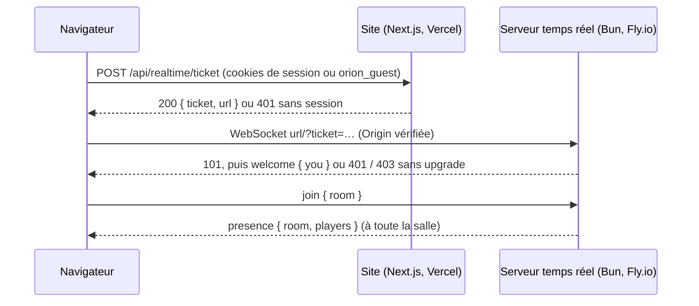

# Architecture

## ADR — technologie temps réel

**Statut :** accepté (TECH-06). **Exigences liées :** TECH-06, TECH-07, PERF-02 ; prépare CONF-12, COURSE-05, COURSE-06, COURSE-08.

### Contexte

- TECH-06 demande de voir la progression des participants en temps réel, technologie libre.
- COURSE-06 demande un serveur autoritaire : départ, fin, progression, classement et bonus décidés par le serveur. Il lui faut donc un état de course vivant, partagé par tous les joueurs d'une salle.
- Le site (Next.js) est hébergé sur Vercel. Ses fonctions serverless ne gardent pas de connexion WebSocket ouverte et ne partagent pas de mémoire d'un appel à l'autre.
- PERF-02 : au plus environ 10 mises à jour de progression par seconde et par joueur, sans écriture en base à chaque frappe.
- TECH-07 : chaque message temps réel reçu par le serveur est validé par un schéma.
- TECH-08 : coût nul ou presque.

### Options considérées

| Option | Pour | Contre |
|---|---|---|
| **Serveur Bun WebSocket séparé** (`Bun.serve` avec `websocket`), état en mémoire | Même langage et même runtime que le site ; pub/sub par salle intégré ; l'état de course vit dans le processus, ce qui rend COURSE-06 simple ; aucun service payant | Un deuxième déploiement, hors Vercel ; une seule instance tant que l'état est en mémoire |
| Service géré (Pusher, Ably, Supabase Realtime, Liveblocks) | Rien à héberger ; marche depuis Vercel | Le service relaie, il ne décide pas : COURSE-06 demanderait quand même un serveur ; quotas gratuits limités ; dépendance externe |
| Polling ou Server-Sent Events depuis Next.js sur Vercel | Un seul déploiement | Pas d'état partagé entre fonctions (il faudrait Redis ou la base à chaque frappe, contre PERF-02) ; latence ; SSE limité par la durée des fonctions |
| Socket.IO sur Node | Reconnexion et salles toutes faites | Dépendance lourde ; l'authentification exige Node et non Bun (`Bun.password`) ; rien que `Bun.serve` ne fasse déjà |
| MQTT (broker Mosquitto ou EMQX) | Pub/sub standard | Un broker en plus, et toujours un serveur à côté pour décider de la course |

### Décision

Un serveur Bun WebSocket séparé de Next.js, dans `src/realtime/`, qui garde l'état des salles en mémoire et fera foi pour la course (COURSE-06). Il est hébergé sur **Fly.io** (offre gratuite, une machine `shared-cpu-1x` 256 Mo, région `yul`), configuré par `fly.toml` et `Dockerfile.realtime`. Le site reste sur Vercel.

L'identité vient d'un **ticket** : le serveur temps réel est sur un autre domaine que le site, les cookies de session n'y arrivent donc pas. `/api/realtime/ticket` (Next.js) lit la session Better Auth, sinon le cookie invité signé `orion_guest`, et remet un ticket signé HMAC-SHA256 avec un secret partagé (`REALTIME_SECRET`), valable 60 s et à usage unique. Aucun message ne porte d'identité : le serveur la tient du ticket. Un compte est désigné par `u:<id du joueur>`, un invité par `g:<uuid>`, l'identifiant aléatoire gardé dans son cookie signé : deux invités au même pseudo (« Alice », « alice ») restent deux joueurs. Un cookie invité émis avant cet identifiant en reçoit un à sa première demande de ticket (cookie réécrit, même pseudo, même expiration).

### Conséquences

- Deux déploiements : Vercel (site, API) et Fly.io (temps réel), avec le même `REALTIME_SECRET` des deux côtés.
- **Une seule instance** : l'état est en mémoire. Passer à plusieurs instances demanderait de router chaque salle vers la même machine (en-tête `fly-replay`) ou de partager l'état (Redis).
- Un redémarrage du serveur vide les salles. Les clients se reconnectent seuls avec un ticket neuf et rejoignent leur salle ; la reprise d'une course en cours (COURSE-08) reste à faire avec COURSE.
- Le serveur temps réel ne lit pas la base pour l'instant : il ne vérifie pas encore qu'une salle existe, sa visibilité ni sa capacité. Ces règles arriveront avec SALLE (SALLE-03, SALLE-05), par un appel à l'API du site ou une connexion à la base.
- **`progress` et `wpm` sont déclarés par le client.** Le serveur les relaie après une validation de forme seulement (types, bornes 0 à 1 et 0 à 500, champs en trop refusés) et la limite de fréquence. Il ne vérifie ni la monotonie, ni une vitesse plausible, ni l'état de la course : un client modifié peut afficher une progression fausse chez les autres. Cette cohérence arrive avec le serveur autoritaire de COURSE-06 ; d'ici là, rien de ce qui est relayé ne sert au classement ni n'est écrit en base.
- **PERF-02, règle retenue :** au plus 10 progressions diffusées par seconde **par salle et par joueur** (une toutes les 100 ms), tous ses onglets confondus ; le client applique la même limite avant d'envoyer, et le serveur fusionne l'excédent (la dernière valeur part). Au-delà de 60 messages par seconde sur une connexion, elle est fermée.
- **Rejeu d'un ticket après redémarrage.** Les nonces des tickets utilisés ne sont gardés qu'en mémoire, et la machine Fly s'arrête quand elle est vide. Pour qu'un ticket capturé ne redevienne pas utilisable après un redémarrage, le serveur refuse tout ticket émis avant son propre démarrage (date d'émission = expiration − 60 s). Risque résiduel accepté : un écart d'horloge entre Vercel et Fly ; il ferait au pire refuser un ticket légitime émis à la seconde du démarrage, et le client en redemande un.
- `REALTIME_ALLOWED_ORIGINS` liste les pages autorisées à se connecter. Les déploiements de prévisualisation Vercel (domaine variable) doivent y être ajoutés pour utiliser le temps réel.

## Flux temps réel

### Composants

| Fichier | Rôle |
|---|---|
| `src/realtime/protocol.ts` | Schémas Zod des messages, partagés client et serveur ; limites (taille, fréquence, MPM max) |
| `src/realtime/ticket.ts` | Signature et vérification des tickets de connexion |
| `src/server/realtime-ticket.ts` | `POST /api/realtime/ticket` : ticket pour la session courante, et l'adresse du serveur |
| `src/realtime/server.ts` | Serveur : connexion, salles en mémoire, présence, diffusion limitée de la progression |
| `src/realtime/main.ts` | Lancement (`bun run realtime`) et configuration par variables d'environnement |
| `src/realtime/client.ts` | Client sans React : ticket, connexion, salle, reconnexion, envoi limité |
| `src/realtime/useRealtimeRoom.ts` | Hook React pour les pages |
| `src/views/room/live.ts`, `src/views/room/LiveList.tsx` | Présents et progression en direct, affichés dans la salle (`/room`) et dans l'en-tête de la course (`/game`), qui envoie aussi la progression locale |

### Connexion

### Messages

Client vers serveur (validés par `ClientMessage`, champs en trop refusés) :

| Message | Champs | Effet |
|---|---|---|
| `join` | `room` : code SALLE-02 | Quitte la salle précédente, rejoint celle-ci, diffuse la présence |
| `leave` | — | Quitte la salle, diffuse la présence |
| `progress` | `progress` : 0 à 1 (annexe A), `wpm` : 0 à 500 | Diffusé aux autres membres de la salle, limité à 10 par seconde par joueur |

Serveur vers client (validés par `ServerMessage` côté client) :

| Message | Champs | Quand |
|---|---|---|
| `welcome` | `you` : `{ id, name, guest }` | À l'ouverture |
| `presence` | `room`, `players` | À chaque arrivée ou départ dans la salle |
| `progress` | `playerId`, `progress`, `wpm` | Progression d'un autre joueur |
| `error` | `code` : `invalid_message`, `not_in_room` | Message rejeté ; rien n'est diffusé |

### Règles du serveur

- Connexion refusée sans ticket valide, avec un ticket expiré, déjà utilisé, émis avant le démarrage du serveur ou signé par un autre secret, ou depuis une origine non autorisée.
- Message invalide (JSON cassé, type inconnu, valeur hors bornes, champ en trop, trame binaire) : `error invalid_message` à l'expéditeur seulement ; la connexion reste ouverte.
- Message de plus de 1 Ko : la connexion est fermée par Bun. Plus de 60 messages en une seconde : fermeture 1008.
- Progression (PERF-02) : au plus une diffusion toutes les 100 ms par salle et par joueur, onglets compris. Les messages en trop sont fusionnés et la dernière valeur part dès que la limite le permet. Le client applique la même limite avant d'envoyer. Rien n'est écrit en base.
- Présence : un joueur ouvert dans deux onglets n'apparaît qu'une fois et reste présent tant qu'un onglet est connecté.

## Déployer le serveur temps réel

Rien n'est déployé par le dépôt. Pour mettre le serveur en ligne sur Fly.io :

1. `fly launch --no-deploy --copy-config` (garde `fly.toml`), puis `fly secrets set REALTIME_SECRET=<le même que sur Vercel>`.
2. `fly deploy --ha=false` : une seule machine, puisque l'état est en mémoire.
3. Sur Vercel : `REALTIME_SECRET` (même valeur) et `REALTIME_PUBLIC_URL=wss://orion-realtime.fly.dev`.
4. Ajuster `REALTIME_ALLOWED_ORIGINS` dans `fly.toml` si le domaine du site change.
