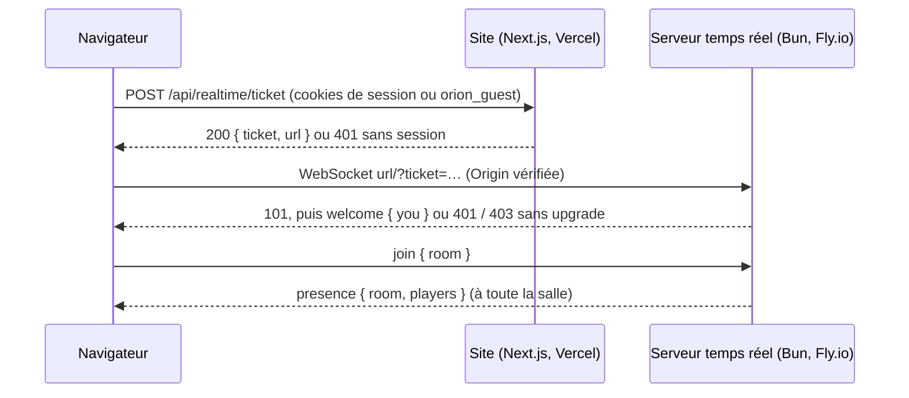

# Architecture

## ADR — technologie temps réel

**Statut :** accepté (TECH-06). **Exigences liées :** TECH-06, TECH-07, PERF-02 ; prépare CONF-12, COURSE-05, COURSE-06, COURSE-08.

### Contexte

- TECH-06 demande de voir la progression des participants en temps réel, technologie libre.
- COURSE-06 demande un serveur autoritaire : départ, fin, progression, classement et bonus décidés par le serveur. Il lui faut donc un état de course vivant, partagé par tous les joueurs d'une salle.
- Le site (Next.js) est hébergé sur Vercel. Ses fonctions serverless ne gardent pas de connexion WebSocket ouverte et ne partagent pas de mémoire d'un appel à l'autre.
- PERF-02 : au plus environ 10 mises à jour de progression par seconde et par joueur, sans écriture en base à chaque frappe.
- TECH-07 : chaque message temps réel reçu par le serveur est validé par un schéma.
- TECH-08 : coût nul ou presque.

### Options considérées

| Option | Pour | Contre |
|---|---|---|
| **Serveur Bun WebSocket séparé** (`Bun.serve` avec `websocket`), état en mémoire | Même langage et même runtime que le site ; pub/sub par salle intégré ; l'état de course vit dans le processus, ce qui rend COURSE-06 simple ; aucun service payant | Un deuxième déploiement, hors Vercel ; une seule instance tant que l'état est en mémoire |
| Service géré (Pusher, Ably, Supabase Realtime, Liveblocks) | Rien à héberger ; marche depuis Vercel | Le service relaie, il ne décide pas : COURSE-06 demanderait quand même un serveur ; quotas gratuits limités ; dépendance externe |
| Polling ou Server-Sent Events depuis Next.js sur Vercel | Un seul déploiement | Pas d'état partagé entre fonctions (il faudrait Redis ou la base à chaque frappe, contre PERF-02) ; latence ; SSE limité par la durée des fonctions |
| Socket.IO sur Node | Reconnexion et salles toutes faites | Dépendance lourde ; l'authentification exige Node et non Bun (`Bun.password`) ; rien que `Bun.serve` ne fasse déjà |
| MQTT (broker Mosquitto ou EMQX) | Pub/sub standard | Un broker en plus, et toujours un serveur à côté pour décider de la course |

### Décision

Un serveur Bun WebSocket séparé de Next.js, dans `src/realtime/`, qui garde l'état des salles en mémoire et fera foi pour la course (COURSE-06). Il est hébergé sur **Fly.io** (offre gratuite, une machine `shared-cpu-1x` 256 Mo, région `yul`), configuré par `fly.toml` et `Dockerfile.realtime`. Le site reste sur Vercel.

L'identité vient d'un **ticket** : le serveur temps réel est sur un autre domaine que le site, les cookies de session n'y arrivent donc pas. `/api/realtime/ticket` (Next.js) lit la session Better Auth, sinon le cookie invité signé `orion_guest`, et remet un ticket signé HMAC-SHA256 avec un secret partagé (`REALTIME_SECRET`), valable 60 s et à usage unique. Aucun message ne porte d'identité : le serveur la tient du ticket. Un compte est désigné par `u:<id du joueur>`, un invité par `g:<uuid>`, l'identifiant aléatoire gardé dans son cookie signé : deux invités au même pseudo (« Alice », « alice ») restent deux joueurs. Un cookie invité émis avant cet identifiant en reçoit un à sa première demande de ticket (cookie réécrit, même pseudo, même expiration).

### Conséquences

- Deux déploiements : Vercel (site, API) et Fly.io (temps réel), avec le même `REALTIME_SECRET` des deux côtés.
- **Une seule instance** : l'état est en mémoire. Passer à plusieurs instances demanderait de router chaque salle vers la même machine (en-tête `fly-replay`) ou de partager l'état (Redis).
- Un redémarrage du serveur vide les salles. Les clients se reconnectent seuls avec un ticket neuf et rejoignent leur salle ; la reprise d'une course en cours (COURSE-08) reste à faire avec COURSE.
- **Suivi d'un salon** (`join` avec `follow`, page salle) : avec `DATABASE_URL`, le serveur temps réel lit la base (`src/realtime/room-backend.ts`, logique dans `src/server/rooms.ts`). Seul un membre suit un salon (SALLE-03) ; il reçoit l'état du salon à chaque changement et à chaque échéance (SALLE-08, SALLE-09) ; un membre expulsé reçoit `not_member` (SALLE-07) ; un non-membre reçoit la même réponse pour un salon fermé, étranger ou inconnu (SALLE-10). Sa dernière page salle fermée, il quitte le salon après 15 s, sauf pendant une course.
- **Pont site → temps réel** : chaque route `/api/rooms` qui change un salon fait `NOTIFY orion_rooms, '<code>'` (`src/server/room-events.ts`) ; le serveur temps réel écoute ce canal (`LISTEN`, connexion directe à Postgres, pas par un pooler en mode transaction). Une annonce perdue n'est pas grave : la page relit l'état par HTTP tant que le temps réel n'est pas joignable (`watchRoom`).
- Avec la base, tout `join` (page course comprise) exige d'être membre du salon : un non-membre reçoit `not_member`, la même réponse pour un code inconnu (SALLE-03, SALLE-10), et ne publie aucune progression (SALLE-09). Le contrôle se fait en base, donc en différé : seule la dernière demande de la socket aboutit (un `leave` ou un autre `join` envoyé entre-temps l'annule), et un salon changé pendant le contrôle (expulsion, départ) est relu avant d'admettre le joueur (TECH-06). Sans `DATABASE_URL`, la présence reste ouverte à tout code.
- **Serveur autoritaire (COURSE-06)** : avec la base, le serveur temps réel arbitre chaque progression avant de la relayer, et calcule le classement ; voir « Serveur autoritaire » plus bas. Sans `DATABASE_URL` (outils, tests), il n'y a pas de course connue : la progression est relayée après la seule validation de forme.
- **PERF-02, règle retenue :** au plus 10 progressions diffusées par seconde **par salle et par joueur** (une toutes les 100 ms), tous ses onglets confondus ; le client applique la même limite avant d'envoyer, et le serveur fusionne l'excédent (la dernière valeur part). Au-delà de 60 messages par seconde sur une connexion, elle est fermée.
- **Rejeu d'un ticket après redémarrage.** Les nonces des tickets utilisés ne sont gardés qu'en mémoire, et la machine Fly s'arrête quand elle est vide. Pour qu'un ticket capturé ne redevienne pas utilisable après un redémarrage, le serveur refuse tout ticket émis avant son propre démarrage (date d'émission = expiration − 60 s). Risque résiduel accepté : un écart d'horloge entre Vercel et Fly ; il ferait au pire refuser un ticket légitime émis à la seconde du démarrage, et le client en redemande un.
- `REALTIME_ALLOWED_ORIGINS` liste les pages autorisées à se connecter. Les déploiements de prévisualisation Vercel (domaine variable) doivent y être ajoutés pour utiliser le temps réel.

## Flux temps réel

### Composants

| Fichier | Rôle |
|---|---|
| `src/realtime/protocol.ts` | Schémas Zod des messages, partagés client et serveur ; limites (taille, fréquence, MPM max) |
| `src/realtime/ticket.ts` | Signature et vérification des tickets de connexion |
| `src/server/realtime-ticket.ts` | `POST /api/realtime/ticket` : ticket pour la session courante, et l'adresse du serveur |
| `src/realtime/server.ts` | Serveur : connexion, salles en mémoire, présence, arbitrage et diffusion limitée de la progression, classement |
| `src/realtime/referee.ts` | COURSE-06 : règles pures de l'arbitre (seuils, verdict, classement) |
| `src/rooms/race-clock.ts` | COURSE-06 : départ et fin d'une course depuis `launched_at` |
| `src/realtime/main.ts` | Lancement (`bun run realtime`) et configuration par variables d'environnement |
| `src/realtime/client.ts` | Client sans React : ticket, connexion, salle, reconnexion, envoi limité |
| `src/realtime/useRealtimeRoom.ts` | Hook React pour les pages |
| `src/views/room/live.ts`, `src/views/room/LiveList.tsx` | Présents et progression en direct, affichés dans la salle (`/room`) et dans l'en-tête de la course (`/game`), qui envoie aussi la progression locale |

### Connexion

### Messages

Client vers serveur (validés par `ClientMessage`, champs en trop refusés) :

| Message | Champs | Effet |
|---|---|---|
| `join` | `room` : code SALLE-02 | Quitte la salle précédente, rejoint celle-ci, diffuse la présence |
| `leave` | — | Quitte la salle, diffuse la présence |
| `progress` | `progress` : 0 à 1 (annexe A), `wpm` : 0 à 300 (MPM humain maximal, COURSE-06) | Diffusé aux autres membres de la salle, limité à 10 par seconde par joueur |

Serveur vers client (validés par `ServerMessage` côté client) :

| Message | Champs | Quand |
|---|---|---|
| `welcome` | `you` : `{ id, name, guest }` | À l'ouverture |
| `presence` | `room`, `players` | À chaque arrivée ou départ dans la salle |
| `progress` | `playerId`, `progress`, `wpm` | Progression acceptée d'un autre joueur |
| `standings` | `room`, `startsAt`, `endsAt` (ms epoch, null sans limite), `players` : `{ playerId, rank, progress, wpm, finishedMs }` | COURSE-06 : à l'entrée dans une salle en course, puis au plus 10 fois par seconde, à toute la salle |
| `error` | `code` : `invalid_message`, `not_in_room`, `not_member`, `not_a_runner`, `race_not_started`, `race_over`, `progress_backward`, `progress_jump`, `progress_too_fast` | Message rejeté ; rien n'est diffusé |

### Règles du serveur

- Connexion refusée sans ticket valide, avec un ticket expiré, déjà utilisé, émis avant le démarrage du serveur ou signé par un autre secret, ou depuis une origine non autorisée.
- Message invalide (JSON cassé, type inconnu, valeur hors bornes, champ en trop, trame binaire) : `error invalid_message` à l'expéditeur seulement ; la connexion reste ouverte.
- Message de plus de 1 Ko : la connexion est fermée par Bun. Plus de 60 messages en une seconde : fermeture 1008.
- Progression (PERF-02) : au plus une diffusion toutes les 100 ms par salle et par joueur, onglets compris. Les messages en trop sont fusionnés et la dernière valeur part dès que la limite le permet. Le client applique la même limite avant d'envoyer. Rien n'est écrit en base.
- Présence : un joueur ouvert dans deux onglets n'apparaît qu'une fois et reste présent tant qu'un onglet est connecté.

## Serveur autoritaire (COURSE-06)

**Le serveur temps réel est obligatoire en production.** C'est lui qui arbitre la course ; sans lui, aucune arrivée n'est validée, aucune course ne se termine avant son échéance et les courses enregistrées sont toutes marquées non finies. Il n'y a pas de repli côté navigateur. Le site démarre quand même (le dev local n'est pas bloqué), mais l'absence se voit : avertissement au démarrage de Next.js (`instrumentation.ts`) et champ `realtime: { required, configured, missing }` dans `GET /api/health`, dès que `REALTIME_PUBLIC_URL` ou `REALTIME_SECRET` manque en production (`NODE_ENV` ou `VERCEL_ENV` à `production`, `src/server/realtime-config.ts`).

Le navigateur tape et compte ; le serveur décide. Qui décide quoi :

| Quoi | Qui décide | Où |
|---|---|---|
| Départ de la course | Le serveur : `startsAt = launched_at + 3 s` (décompte COURSE-03), horloge de la base | `src/rooms/race-clock.ts`, vue du salon (`startsAt`, `endsAt`), message `standings` |
| Fin par le temps | Le serveur : `endsAt = startsAt + durée` ; toute progression après `endsAt + 1 s` est refusée (`race_over`). Le salon passe aux résultats à l'échéance SALLE-09 (`launched_at + durée + 30 s`) | `referee.ts`, `sweep` dans `src/server/rooms.ts` |
| Fin quand tous sont arrivés | Le serveur : à 100 % validé, le temps réel note l'arrivée (`room_members.progress = 1`, `finished_at`) ; le dernier coureur humain arrivé passe le salon aux résultats. `POST /api/rooms/:code/finish` (la page qui se déclare arrivée) est ignoré tant que le serveur n'a pas validé 100 %, décompte compris | `recordProgress`, `finishRoom` (`src/server/rooms.ts`), `endIfAllFinished` |
| Progression | Le client la déclare (mots validés ÷ mots du texte) ; le serveur l'accepte ou la refuse, garde la dernière acceptée par coureur, et ne relaie que celle-là | `judge` dans `src/realtime/referee.ts` |
| Classement | Le serveur : arrivés par heure d'arrivée serveur, puis les autres par progression | `standings` dans `referee.ts` |
| Enregistrement (`POST /api/races`) | Le serveur refuse ou corrige : voir plus bas | `claimServerRace` dans `src/server/races.ts` |
| Bonus (BONUS-01 à 04) | Pas codés. Point d'application prévu : le serveur temps réel, dans `referee` (`src/realtime/server.ts`) ; un bonus qui ajoute ou retire des mots devra modifier `course.marks` de la salle (longueur du texte, annexe A) pour que l'arbitre continue de compter juste | — |

Le texte est connu du serveur : il retire les mots comme la page de course, avec les mêmes réglages, la même graine et le même passage (CONF-03, `raceCourseOf` dans `src/realtime/room-backend.ts`). Il compte donc lui-même les caractères validés (espaces comprises, annexe A) à chaque progression. Sans graine (salon lancé avant CONF-03), seules les règles d'horloge et de recul s'appliquent.

**Empreinte du texte** : au lancement, le site enregistre l'empreinte des mots tirés (`rooms.text_hash`, FNV-1a sur 32 bits, `src/rooms/course-words.ts`) ; elle figure dans la vue du salon (`textHash`). Le serveur temps réel recalcule l'empreinte avec son propre code. Si elle diffère (site et temps réel déployés à des versions différentes), il refuse d'arbitrer les caractères et l'écrit dans ses journaux (`COURSE-06: text fingerprint mismatch…`) : seules les règles d'horloge et de recul restent, au lieu de refuser à tort des progressions honnêtes sans rien dire.

**Seuils** (`src/realtime/referee.ts`) :

- MPM humain maximal : **300** (record humain soutenu autour de 200 à 250, pointes vers 300), soit **25 caractères par seconde**. Le même plafond borne le `wpm` d'un message `progress` (au-delà : `invalid_message`), donc le MPM relayé et celui de `standings`.
- Marge : **40 caractères** (deux mots validés qui arrivent dans le même paquet).
- Horloges : **1 s** de tolérance entre la base (`launched_at`) et le serveur temps réel.

**Refus** (erreur à l'expéditeur seulement, rien n'est gardé ni diffusé) :

- `race_not_started` : avant `startsAt − 1 s`, ou salon pas encore en course ;
- `race_over` : après `endsAt + 1 s`, ou salon sorti de la course ;
- `not_a_runner` : un spectateur ou un non-participant ;
- `progress_backward` : plus bas que la dernière progression acceptée (la même valeur est acceptée : un client reconnecté la renvoie) ;
- `progress_too_fast` (vitesse irréaliste) : plus de `25 × secondes depuis startsAt (+1 s) + 40` caractères validés ;
- `progress_jump` (saut) : plus de `25 × secondes depuis la dernière progression acceptée + 40` caractères de plus qu'elle.

Un coureur légitime refusé (paquets groupés) n'est pas bloqué : la marge autorisée grandit avec le temps écoulé depuis sa dernière progression acceptée. Le classement est gardé en mémoire tant qu'un joueur est dans la salle ; la dernière progression d'un coureur qui s'en va est écrite en base.

**Enregistrement d'une course** (`POST /api/races`) : choix retenu, **refuser** ce qui contredit le serveur et **corriger** ce qu'il sait mieux.

- Refusé, 409 `race_not_launched` : pas de `room` dans le corps, salon inconnu ou fermé, expéditeur pas membre, salon jamais lancé.
- Refusé, 422 `race_contradicted` : un joueur du corps a couru plus longtemps que le temps écoulé depuis le départ serveur (+2 s), ou à plus de 300 MPM.
- Refusé, 409 `duplicate_race` : ce membre a déjà enregistré ce lancement, même avec un nouvel identifiant (réservation conditionnelle sur `room_members.race_recorded`, remise à faux à chaque lancement).
- Corrigé : `finished` du compte vient de la progression validée par le temps réel (`room_members.progress = 1`) ; le départ (`races.started_at`) est le départ serveur ; le **rang** des humains est celui du serveur (arrivés par `finished_at`, puis par progression validée), quel que soit l'ordre du corps ; les bots, simulés par le navigateur (BOT-*), gardent leur place (`rankByServer`).
- Reste du navigateur : MPM, précision et résultats des bots (bornés par les refus ci-dessus).

## Déployer le serveur temps réel

Rien n'est déployé par le dépôt. Pour mettre le serveur en ligne sur Fly.io :

1. `fly launch --no-deploy --copy-config` (garde `fly.toml`), puis `fly secrets set REALTIME_SECRET=<le même que sur Vercel>`.
2. `fly deploy --ha=false` : une seule machine, puisque l'état est en mémoire.
3. Sur Vercel : `REALTIME_SECRET` (même valeur) et `REALTIME_PUBLIC_URL=wss://orion-realtime.fly.dev`.
4. Ajuster `REALTIME_ALLOWED_ORIGINS` dans `fly.toml` si le domaine du site change.
