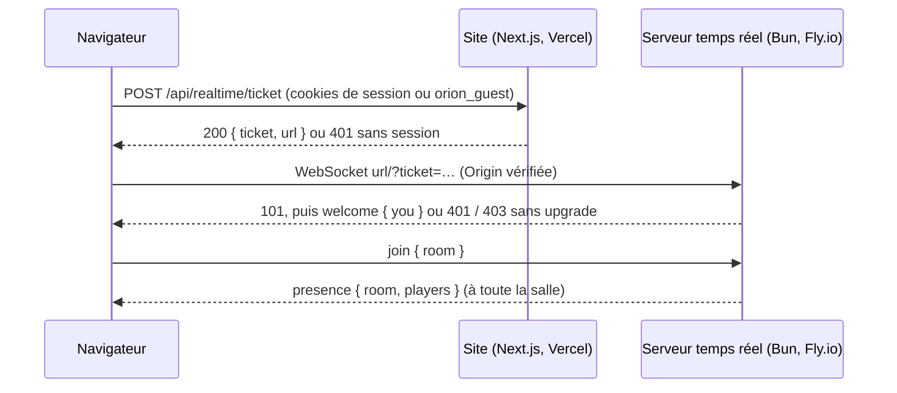
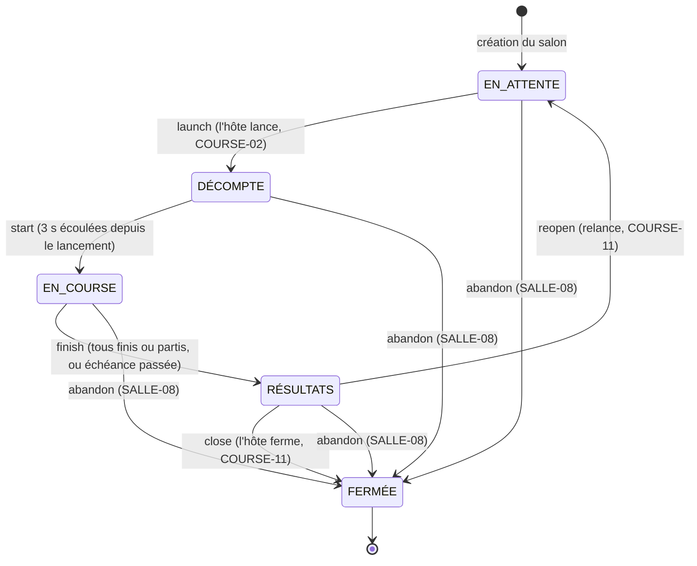

# Architecture

## ADR — technologie temps réel

**Statut :** accepté (TECH-06). **Exigences liées :** TECH-06, TECH-07, PERF-02 ; prépare CONF-12, COURSE-05, COURSE-06, COURSE-08.

### Contexte

- TECH-06 demande de voir la progression des participants en temps réel, technologie libre.
- COURSE-06 demande un serveur autoritaire : départ, fin, progression, classement et bonus décidés par le serveur. Il lui faut donc un état de course vivant, partagé par tous les joueurs d'une salle.
- Le site (Next.js) est hébergé sur Vercel. Ses fonctions serverless ne gardent pas de connexion WebSocket ouverte et ne partagent pas de mémoire d'un appel à l'autre.
- PERF-02 : au plus environ 10 mises à jour de progression par seconde et par joueur, sans écriture en base à chaque frappe.
- TECH-07 : chaque message temps réel reçu par le serveur est validé par un schéma.
- TECH-08 : coût nul ou presque.

### Options considérées

| Option | Pour | Contre |
|---|---|---|
| **Serveur Bun WebSocket séparé** (`Bun.serve` avec `websocket`), état en mémoire | Même langage et même runtime que le site ; pub/sub par salle intégré ; l'état de course vit dans le processus, ce qui rend COURSE-06 simple ; aucun service payant | Un deuxième déploiement, hors Vercel ; une seule instance tant que l'état est en mémoire |
| Service géré (Pusher, Ably, Supabase Realtime, Liveblocks) | Rien à héberger ; marche depuis Vercel | Le service relaie, il ne décide pas : COURSE-06 demanderait quand même un serveur ; quotas gratuits limités ; dépendance externe |
| Polling ou Server-Sent Events depuis Next.js sur Vercel | Un seul déploiement | Pas d'état partagé entre fonctions (il faudrait Redis ou la base à chaque frappe, contre PERF-02) ; latence ; SSE limité par la durée des fonctions |
| Socket.IO sur Node | Reconnexion et salles toutes faites | Dépendance lourde ; l'authentification exige Node et non Bun (`Bun.password`) ; rien que `Bun.serve` ne fasse déjà |
| MQTT (broker Mosquitto ou EMQX) | Pub/sub standard | Un broker en plus, et toujours un serveur à côté pour décider de la course |

### Décision

Un serveur Bun WebSocket séparé de Next.js, dans `src/realtime/`, qui garde l'état des salles en mémoire et fera foi pour la course (COURSE-06). Il est hébergé sur **Fly.io** (offre gratuite, une machine `shared-cpu-1x` 256 Mo, région `yul`), configuré par `fly.toml` et `Dockerfile.realtime`. Le site reste sur Vercel.

L'identité vient d'un **ticket** : le serveur temps réel est sur un autre domaine que le site, les cookies de session n'y arrivent donc pas. `/api/realtime/ticket` (Next.js) lit la session Better Auth, sinon le cookie invité signé `orion_guest`, et remet un ticket signé HMAC-SHA256 avec un secret partagé (`REALTIME_SECRET`), valable 60 s et à usage unique. Aucun message ne porte d'identité : le serveur la tient du ticket. Un compte est désigné par `u:<id du joueur>`, un invité par `g:<uuid>`, l'identifiant aléatoire gardé dans son cookie signé : deux invités au même pseudo (« Alice », « alice ») restent deux joueurs. Un cookie invité émis avant cet identifiant en reçoit un à sa première demande de ticket (cookie réécrit, même pseudo, même expiration).

### Conséquences

- Deux déploiements : Vercel (site, API) et Fly.io (temps réel), avec le même `REALTIME_SECRET` des deux côtés.
- **Une seule instance** : l'état est en mémoire. Passer à plusieurs instances demanderait de router chaque salle vers la même machine (en-tête `fly-replay`) ou de partager l'état (Redis).
- Un redémarrage du serveur vide les salles. Les clients se reconnectent seuls avec un ticket neuf et rejoignent leur salle. Une course en cours reprend (COURSE-08, « Déconnexion et reprise » plus bas) : l'arbitre relit en base la dernière progression gardée de chaque coureur (`room_members.progress`), et chaque page reprend son texte, son horloge et ses comptes. Les progressions acceptées depuis la dernière écriture en base (fermeture de socket, abandon, fin) sont perdues : le coureur reprend un peu plus tôt, jamais plus loin.
- **Suivi d'un salon** (`join` avec `follow`, page salle) : avec `DATABASE_URL`, le serveur temps réel lit la base (`src/realtime/room-backend.ts`, logique dans `src/server/rooms.ts`). Seul un membre suit un salon (SALLE-03) ; il reçoit l'état du salon à chaque changement et à chaque échéance (SALLE-08, SALLE-09) ; un membre expulsé reçoit `not_member` (SALLE-07) ; un non-membre reçoit la même réponse pour un salon fermé, étranger ou inconnu (SALLE-10). Sa dernière page salle fermée, il quitte le salon après 15 s, sauf pendant une course.
- **Pont site → temps réel** : chaque route `/api/rooms` qui change un salon fait `NOTIFY orion_rooms, '<code>'` (`src/server/room-events.ts`) ; le serveur temps réel écoute ce canal (`LISTEN`, connexion directe à Postgres, pas par un pooler en mode transaction). Une annonce perdue n'est pas grave : la page relit l'état par HTTP tant que le temps réel n'est pas joignable (`watchRoom`).
- Avec la base, tout `join` (page course comprise) exige d'être membre du salon : un non-membre reçoit `not_member`, la même réponse pour un code inconnu (SALLE-03, SALLE-10), et ne publie aucune progression (SALLE-09). Le contrôle se fait en base, donc en différé : seule la dernière demande de la socket aboutit (un `leave` ou un autre `join` envoyé entre-temps l'annule), et un salon changé pendant le contrôle (expulsion, départ) est relu avant d'admettre le joueur (TECH-06). Sans `DATABASE_URL`, la présence reste ouverte à tout code.
- **Serveur autoritaire (COURSE-06)** : avec la base, le serveur temps réel arbitre chaque progression avant de la relayer, et calcule le classement ; voir « Serveur autoritaire » plus bas. Sans `DATABASE_URL` (outils, tests), il n'y a pas de course connue : la progression est relayée après la seule validation de forme.
- **PERF-02, règle retenue :** au plus 10 progressions diffusées par seconde **par salle et par joueur** (une toutes les 100 ms), tous ses onglets confondus ; le client applique la même limite avant d'envoyer, et le serveur fusionne l'excédent (la dernière valeur part). Au-delà de 60 messages par seconde sur une connexion, elle est fermée.
- **Rejeu d'un ticket après redémarrage.** Les nonces des tickets utilisés ne sont gardés qu'en mémoire, et la machine Fly s'arrête quand elle est vide. Pour qu'un ticket capturé ne redevienne pas utilisable après un redémarrage, le serveur refuse tout ticket émis avant son propre démarrage (date d'émission = expiration − 60 s). Risque résiduel accepté : un écart d'horloge entre Vercel et Fly ; il ferait au pire refuser un ticket légitime émis à la seconde du démarrage, et le client en redemande un.
- `REALTIME_ALLOWED_ORIGINS` liste les pages autorisées à se connecter. Les déploiements de prévisualisation Vercel (domaine variable) doivent y être ajoutés pour utiliser le temps réel.

## Flux temps réel

### Composants

| Fichier | Rôle |
|---|---|
| `src/realtime/protocol.ts` | Schémas Zod des messages, partagés client et serveur ; limites (taille, fréquence, MPM max) |
| `src/realtime/ticket.ts` | Signature et vérification des tickets de connexion |
| `src/server/realtime-ticket.ts` | `POST /api/realtime/ticket` : ticket pour la session courante, et l'adresse du serveur |
| `src/realtime/server.ts` | Serveur : connexion, salles en mémoire, présence, arbitrage et diffusion limitée de la progression, classement |
| `src/realtime/referee.ts` | COURSE-06 : règles pures de l'arbitre (seuils, verdict, classement) |
| `src/rooms/race-clock.ts` | COURSE-06 : départ et fin d'une course depuis `launched_at` |
| `src/realtime/main.ts` | Lancement (`bun run realtime`) et configuration par variables d'environnement |
| `src/realtime/client.ts` | Client sans React : ticket, connexion, salle, reconnexion, envoi limité |
| `src/realtime/useRealtimeRoom.ts` | Hook React pour les pages |
| `src/views/room/live.ts`, `src/views/room/LiveList.tsx` | Présents et progression en direct, affichés dans la salle (`/room`) et dans l'en-tête de la course (`/game`), qui envoie aussi la progression locale |

### Connexion

### Messages

Client vers serveur (validés par `ClientMessage`, champs en trop refusés) :

| Message | Champs | Effet |
|---|---|---|
| `join` | `room` : code SALLE-02 | Quitte la salle précédente, rejoint celle-ci, diffuse la présence |
| `leave` | — | Quitte la salle, diffuse la présence |
| `progress` | `progress` : 0 à 1 (annexe A), `wpm` : 0 à 300 (MPM humain maximal, COURSE-06) | Diffusé aux autres membres de la salle, limité à 10 par seconde par joueur |

Serveur vers client (validés par `ServerMessage` côté client) :

| Message | Champs | Quand |
|---|---|---|
| `welcome` | `you` : `{ id, name, guest }` | À l'ouverture |
| `presence` | `room`, `players` | À chaque arrivée ou départ dans la salle |
| `progress` | `playerId`, `progress`, `wpm` | Progression acceptée d'un autre joueur |
| `standings` | `room`, `startsAt`, `endsAt` (ms epoch, null sans limite), `players` : `{ playerId, rank, progress, wpm, finishedMs }` | COURSE-06 : à l'entrée dans une salle en course, puis au plus 10 fois par seconde, à toute la salle |
| `error` | `code` : `invalid_message`, `not_in_room`, `not_member`, `not_a_runner`, `race_not_started`, `race_over`, `progress_backward`, `progress_jump`, `progress_too_fast` | Message rejeté ; rien n'est diffusé |

### Règles du serveur

- Connexion refusée sans ticket valide, avec un ticket expiré, déjà utilisé, émis avant le démarrage du serveur ou signé par un autre secret, ou depuis une origine non autorisée.
- Message invalide (JSON cassé, type inconnu, valeur hors bornes, champ en trop, trame binaire) : `error invalid_message` à l'expéditeur seulement ; la connexion reste ouverte.
- Message de plus de 1 Ko : la connexion est fermée par Bun. Plus de 60 messages en une seconde : fermeture 1008.
- Progression (PERF-02) : au plus une diffusion toutes les 100 ms par salle et par joueur, onglets compris. Les messages en trop sont fusionnés et la dernière valeur part dès que la limite le permet. Le client applique la même limite avant d'envoyer. Rien n'est écrit en base.
- Présence : un joueur ouvert dans deux onglets n'apparaît qu'une fois et reste présent tant qu'un onglet est connecté.

## Serveur autoritaire (COURSE-06)

**Le serveur temps réel est obligatoire en production.** C'est lui qui arbitre la course ; sans lui, aucune arrivée n'est validée, aucune course ne se termine avant son échéance et les courses enregistrées sont toutes marquées non finies. Il n'y a pas de repli côté navigateur. Le site démarre quand même (le dev local n'est pas bloqué), mais l'absence se voit : avertissement au démarrage de Next.js (`instrumentation.ts`) et champ `realtime: { required, configured, missing }` dans `GET /api/health`, dès que `REALTIME_PUBLIC_URL` manque, ou qu'aucun secret de ticket valable n'est défini (`REALTIME_SECRET`, sinon `BETTER_AUTH_SECRET`, 32 caractères minimum, comme la signature des tickets), en production (`NODE_ENV` ou `VERCEL_ENV` à `production`, `src/server/realtime-config.ts`).

Le navigateur tape et compte ; le serveur décide. Qui décide quoi :

| Quoi | Qui décide | Où |
|---|---|---|
| Départ de la course | Le serveur : `startsAt = launched_at + 6 s` (préparation de 3 s puis décompte 3, 2, 1, COURSE-03), horloge de la base | `src/rooms/race-clock.ts`, vue du salon (`startsAt`, `endsAt`), message `standings` |
| Fin par le temps | Le serveur : `endsAt = startsAt + durée` ; toute progression après `endsAt + 1 s` est refusée (`race_over`). Le salon passe aux résultats à l'échéance SALLE-09 (`launched_at + durée + 30 s`) | `referee.ts`, `sweep` dans `src/server/rooms.ts` |
| Fin quand tous sont arrivés | Le serveur : à 100 % validé, le temps réel note l'arrivée (`room_members.progress = 1`, `finished_at`) ; le dernier coureur humain arrivé passe le salon aux résultats. `POST /api/rooms/:code/finish` (la page qui se déclare arrivée) est ignoré tant que le serveur n'a pas validé 100 %, décompte compris | `recordProgress`, `finishRoom` (`src/server/rooms.ts`), `endIfAllFinished` |
| Progression | Le client la déclare (mots validés ÷ mots du texte) ; le serveur l'accepte ou la refuse, garde la dernière acceptée par coureur, et ne relaie que celle-là | `judge` dans `src/realtime/referee.ts` |
| Classement | Le serveur : arrivés par heure d'arrivée serveur, puis les autres par progression | `standings` dans `referee.ts` |
| Enregistrement (`POST /api/races`) | Le serveur refuse ou corrige : voir plus bas | `claimServerRace` dans `src/server/races.ts` |
| Bonus (BONUS-01 à 04) | Pas codés. Point d'application prévu : le serveur temps réel, dans `referee` (`src/realtime/server.ts`) ; un bonus qui ajoute ou retire des mots devra modifier `course.marks` de la salle (longueur du texte, annexe A) pour que l'arbitre continue de compter juste | — |

Le texte est connu du serveur : il retire les mots comme la page de course, avec les mêmes réglages, la même graine et le même passage (CONF-03, `raceCourseOf` dans `src/realtime/room-backend.ts`). Il compte donc lui-même les caractères validés (espaces comprises, annexe A) à chaque progression. Sans graine (salon lancé avant CONF-03), seules les règles d'horloge et de recul s'appliquent.

**Empreinte du texte** : au lancement, le site enregistre l'empreinte des mots tirés (`rooms.text_hash`, FNV-1a sur 32 bits, `src/rooms/course-words.ts`) ; elle figure dans la vue du salon (`textHash`). Le serveur temps réel recalcule l'empreinte avec son propre code. Si elle diffère (site et temps réel déployés à des versions différentes), il refuse d'arbitrer les caractères et l'écrit dans ses journaux (`COURSE-06: text fingerprint mismatch…`) : seules les règles d'horloge et de recul restent, au lieu de refuser à tort des progressions honnêtes sans rien dire.

**Seuils** (`src/realtime/referee.ts`) :

- MPM humain maximal : **300** (record humain soutenu autour de 200 à 250, pointes vers 300), soit **25 caractères par seconde**. Le même plafond borne le `wpm` d'un message `progress` (au-delà : `invalid_message`), donc le MPM relayé et celui de `standings`.
- Marge : **40 caractères** (deux mots validés qui arrivent dans le même paquet).
- Horloges : **1 s** de tolérance entre la base (`launched_at`) et le serveur temps réel.

**Refus** (erreur à l'expéditeur seulement, rien n'est gardé ni diffusé) :

- `race_not_started` : avant `startsAt − 1 s`, ou salon pas encore en course ;
- `race_over` : après `endsAt + 1 s`, ou salon sorti de la course ;
- `not_a_runner` : un spectateur ou un non-participant ;
- `progress_backward` : plus bas que la dernière progression acceptée (la même valeur est acceptée : un client reconnecté la renvoie) ;
- `progress_too_fast` (vitesse irréaliste) : plus de `25 × secondes depuis startsAt (+1 s) + 40` caractères validés ;
- `progress_jump` (saut) : plus de `25 × secondes depuis la dernière progression acceptée + 40` caractères de plus qu'elle.

Un coureur légitime refusé (paquets groupés) n'est pas bloqué : la marge autorisée grandit avec le temps écoulé depuis sa dernière progression acceptée. Le classement est gardé en mémoire tant qu'un joueur est dans la salle ; la dernière progression d'un coureur qui s'en va est écrite en base (`room_members.progress`). Quand toutes les sockets d'une salle sont parties (ou que le serveur redémarre), le classement est relu en base au retour des coureurs : chacun reprend sa progression gardée, et un recul reste refusé.

**Enregistrement d'une course** (`POST /api/races`) : choix retenu, **refuser** ce qui contredit le serveur et **corriger** ce qu'il sait mieux.

- Refusé, 409 `race_not_launched` : pas de `room` dans le corps, salon inconnu ou fermé, expéditeur pas membre, salon jamais lancé.
- Refusé, 422 `race_contradicted` : un joueur du corps a couru plus longtemps que le temps écoulé depuis le départ serveur (+2 s), ou à plus de 300 MPM.
- Refusé, 409 `duplicate_race` : ce membre a déjà enregistré ce lancement, même avec un nouvel identifiant (réservation conditionnelle sur `room_members.race_recorded`, remise à faux à chaque lancement).
- Corrigé : `finished` du compte vient de la progression validée par le temps réel (`room_members.progress = 1`) ; le départ (`races.started_at`) est le départ serveur ; le **rang** est refait par le serveur, quel que soit l'ordre du corps (`rankByServer`).
- **Qui est un bot** : le serveur le décide, jamais le drapeau `bot` du corps. Le compte qui envoie et tout membre humain du salon sont humains ; seuls les bots du salon sont des bots : ses membres bots, puis les places libres remplies par la liste fermée `BOT_NAMES` si le salon a les bots activés (comme `seatsOf`). Les noms de `BOT_NAMES` sont réservés : inscription, changement de nom, compte GitHub ou Discord (nom suffixé) et pseudo d'invité les refusent.
- **Règle du rang** : d'abord les humains que le serveur a vus arriver (par heure d'arrivée), puis les bots (dans l'ordre du corps), puis les humains non arrivés selon le serveur (par progression validée), puis les humains inconnus du serveur. Un client ne gagne donc rien avec les bots : aucun bot devant un humain arrivé, aucun humain non arrivé devant un bot.
- **Limite restante** : les bots sont simulés par le navigateur (BOT-*) ; le serveur ne peut pas encore reproduire leur course (graine des bots : BOT-05). Leur ordre entre eux, leurs MPM et leur arrivée viennent du corps, bornés par les refus ci-dessus ; un humain non arrivé mais devant un bot lent dans la vraie course est classé derrière lui.
- Reste du navigateur : MPM, précision et résultats des bots (bornés par les refus ci-dessus).

**Décompte synchronisé (COURSE-03)** : la page de course compte en heure du serveur.
- **Décalage d'horloge** : la vue du salon donne `serverNow`, l'heure de la base (`clock_timestamp()`, même horloge que `launched_at`, donc que `startsAt`), reportée par `src/server/rooms-api.ts` au milieu du traitement de la requête (entre sa réception et sa réponse, par l'écart base / processus mesuré à la lecture). Le navigateur note son heure à l'envoi et à la réception ; décalage = `serverNow − (envoi + réception) / 2` (algorithme de Cristian). L'erreur d'une mesure est au plus la moitié de son aller-retour : `createClockSync` (`src/views/game/countdown.ts`) garde la mesure au plus court aller-retour (de moins de 10 min), prise sur toutes les réponses HTTP du salon (actions, relectures, sondages de `watchRoom`), gardée en `sessionStorage` pour servir sur `/game` après le rechargement ; `/game` relit encore deux fois le salon pour l'affiner. Une réponse lente isolée ne déplace donc rien.
- **Préparation** : `startsAt = lancement + READY_MS (3 s) + 3 s` (`src/rooms/race-clock.ts`). Sans elle, les membres arrivaient sur `/game` après le départ (tampon de 800 ms chez l’hôte, rechargement complet de la page, lecture du salon) et ne voyaient aucun chiffre. Budget estimé : hôte (réponse du lancement, tampon, rechargement, lecture) 1,5 à 2,6 s ; membre prévenu par le temps réel environ 1,5 s ; invité sans temps réel : la salle d’attente relit alors le salon chaque seconde (`WAITING_POLL_MS`, `src/views/room/api.ts`), il arrive au pire vers 2,7 s. Mesuré en production (QA) : 3 onglets sur 3 voient « Prêts ? », 3, 2, 1. Le texte n’apparaît dans la page qu’au « 3 » : pendant « Prêts ? » le panneau de frappe est vide (il est déjà dans la vue du salon, servi au lancement). La page affiche « Prêts ? » pendant la préparation.
- **Décompte** : « Prêts ? », puis 3, 2, 1 (une seconde chacun) avant `startsAt`, puis la frappe s'ouvre et « partez » s'affiche 500 ms (`countdownAt`). Le chiffre est calculé dès le premier affichage : qui arrive ou recharge en plein décompte voit le bon ; qui arrive après le départ court tout de suite, chronométré depuis `startsAt`.
- **Minuteur et fin** : durée = `endsAt − startsAt` ; le minuteur lit `endsAt − maintenant serveur` et la course se termine à `endsAt`.
- **Texte** : passage, graine et empreinte ne figurent dans la vue du salon qu'une fois le salon lancé (`racing` ou `results`), donc au début du décompte ; avant, ils valent `null`, même si des colonnes en base étaient remplies. Le texte personnalisé (mode custom, `settings.text`) n'est donné qu'à l'hôte hors course, en attente comme aux résultats (où les réglages portent déjà le texte de la prochaine course, que l'hôte peut changer) : `roomView` le vide pour tout autre lecteur, et le temps réel envoie à chaque suiveur sa propre vue (`concealText`, `src/rooms/conceal.ts`). Les autres membres lisent « Révélé au lancement ».
- **« Révélé » vise l'écran (décision de l'utilisateur, 2026-11-20)** : le passage, la graine et le texte personnalisé partent dans les données dès le lancement, donc pendant « Prêts ? », 3 s avant le « 3 » ; c'est accepté. Ce qui compte est l'affichage : la page de course ne rend le texte (ni à l'écran ni dans le DOM) qu'à partir du « 3 » (`TypingPanel`). Avant le lancement, rien ne part.
- **Page mobile** : l'avis qui remplace la course sur mobile part au podium à `endsAt` (plus les délais des résultats), en heure du serveur.
- **Classement serveur (`state.race.standings`)** : pas branché sur la piste ni le podium. Il ne classe que les humains (les bots sont simulés par le navigateur) et ne porte ni précision ni touches : il ne remplace pas simplement le classement local, qui mélange humains et bots. La piste montre déjà, pour les autres humains, la progression relayée par le serveur après arbitrage.

## Déconnexion et reprise (COURSE-08)

**Mesure des 30 s** (`src/rooms/reconnect.ts`) : le serveur ne voit pas la coupure, seulement le dernier signe de vie du membre (`room_members.last_seen_at`, heure de la base). Il compte depuis ce signe, au plus tôt depuis le départ (`launched_at + COUNTDOWN_MS`) : un membre silencieux depuis avant le lancement a toute la durée de course pour arriver. Le seuil est `ABANDON_AFTER_MS = RECONNECT_MS (30 s) + RACE_PRESENCE_MS (5 s)`, l'écart maximal entre le dernier signe de vie et la coupure. Un retour dans les 30 s qui suivent la coupure reprend donc toujours la course. Au-delà, l'abandon est noté entre 30 et 35 s après la coupure, plus le délai du balayage (5 s au plus) : 40 s au pire.
- **Signes de vie** : chaque lecture du salon ou action d'un membre (`sweep`). La page de course relit le salon toutes les `RACE_PRESENCE_MS` = 5 s (`src/views/room/presence.ts`, 15 s ailleurs) : au pire, le dernier signe de vie précède la coupure de 5 s. Les pages salle suivies par le temps réel en donnent aussi à chaque balayage (SALLE-08, inchangé). Une progression acceptée par l'arbitre en donne aussi : au balayage suivant du temps réel (5 s au plus), le coureur compte comme présent. Un onglet dont le navigateur ralentit les minuteries (Chrome : un réveil par minute pour un onglet caché depuis 5 min) n'est donc pas noté abandonné tant qu'il court. Une socket de course ouverte mais muette ne compte pas : une connexion morte que le serveur n'a pas encore vue fermée ne retient pas un coureur. Limite acceptée : un coureur qui ne tape plus, dans un onglet caché depuis plus de 5 min, peut être noté abandonné.
- **Balayage** : la règle s'applique dans `sweep`, sous le verrou du salon, avant le signe de vie de qui agit (un retour après 30 s trouve l'abandon). `sweep` tourne à chaque lecture ou action d'un membre (au moins toutes les 5 s tant qu'un coureur est sur `/game`), et le temps réel balaie toutes les 5 s chaque salle où une socket est entrée, page salle ou non : il apprend l'abandon (`syncRace`), garde la progression validée du coureur (`keepValidated`) et refuse la suite (`abandoned`, que la page ouverte reçoit et qui la mène au podium). L'abandon est donc noté entre 35 et 40 s après le dernier signe de vie.
- **Effet** : celui d'`abandonRace` (COURSE-07) : `abandoned_at = now()`, la progression validée reste, l'abandon compte comme une fin (le dernier coureur termine la course). Seulement pour un participant ni arrivé ni ayant abandonné, en course (pas pendant le décompte) et tant que le temps n'est pas écoulé : après `endsAt`, chacun est classé par sa progression.
- **Retour après l'abandon** : `/game` (`src/server/game-gate.ts`) laisse entrer un coureur abandonné dont la course n'est pas encore enregistrée (`room_members.race_recorded`), même si la salle est passée aux résultats (il était le dernier humain). Sa page reprend ce qu'elle gardait (`remountPlan`, `restoreSnapshot`), l'enregistre marquée abandon (le serveur la marque d'après `abandoned_at`), puis va au podium. Une course déjà enregistrée mène directement au podium. Une page remontée après `endsAt` fait de même : elle enregistre ce qu'elle gardait, ou va au podium sans réécrire un résultat à 0 MPM. L'onglet note la course envoyée (`orion.race.<code>.<startsAt>.sent`) pour ne pas la renvoyer.
- **SALLE-08** : `MEMBER_AWAY_MS` (90 s) retire toujours un membre silencieux, en course comme ailleurs ; après 90 s, un coureur abandonné n'est plus membre (`/game` le renvoie à l'accueil).

**Reprise** (`src/views/game/resume.ts`) : un retour dans les 30 s relit le même salon : même texte (graine et passage du serveur), même horloge (`startsAt`, `endsAt` : le chrono reprend, il ne repart pas de la durée). La socket de course rejoint la salle et reçoit le classement du serveur, où figure la dernière progression validée du coureur (en mémoire, ou relue en base si la salle s'était vidée : `leave` l'y écrit à la fermeture de la socket). La page avance une seule fois jusqu'à ce mot (`resumeRace`) : curseur au bon caractère, mots précédents justes, MPM calculée depuis `startsAt`.
- **Frappes et fautes** : la précision enregistrée vient du navigateur, et le serveur ne garde pas les fautes. La page garde donc sa course en cours dans `sessionStorage` (clé `orion.race.<code>.<startsAt>`, une par salon et par départ : une relance ne reprend rien) : position, frappes, fautes, touches, mots manqués, mesures par seconde. Elle l'écrit à chaque frappe, et une page rechargée ne l'écrase qu'après avoir repris (`keepsSnapshot`). À la reprise, ces comptes sont restaurés (plus ce qui a été tapé depuis le rechargement). Seuls les mots validés par le serveur au-delà de ce qui était gardé comptent comme justes. Si la page gardée était plus loin que le serveur, la position reste celle du serveur et les fautes restent comptées. Recharger n'améliore donc pas la précision. Limites : sans stockage (refusé, autre onglet, données effacées), les mots repris comptent comme justes ; et ce stockage, comme toute la précision, reste déclaré par le navigateur.
- **Bots** : simulés par la page, ils sont tirés avec la graine de la course (flux à part de celui des mots) : mêmes vitesses à chaque montage. Une page montée après le départ les avance tick par tick jusqu'à l'heure serveur, au rythme moyen (`mountRace`). Ils sont donc à peu près où ils étaient (les tirages de chaque tick diffèrent), et recharger ne permet pas de les distancer. « Reprise de la course… » s'affiche tant que la page, arrivée en pleine course, attend ce classement. Rien n'est gagné : la page ne va jamais au-delà de la progression validée, et l'arbitre garde la progression d'avant le rechargement (recul et saut refusés comme avant).

## Déployer le serveur temps réel

Rien n'est déployé par le dépôt. Pour mettre le serveur en ligne sur Fly.io :

1. `fly launch --no-deploy --copy-config` (garde `fly.toml`), puis `fly secrets set REALTIME_SECRET=<le même que sur Vercel>`.
2. `fly deploy --ha=false` : une seule machine, puisque l'état est en mémoire.
3. Sur Vercel : `REALTIME_SECRET` (même valeur) et `REALTIME_PUBLIC_URL=wss://typeracer-orion.fly.dev`.
4. Ajuster `REALTIME_ALLOWED_ORIGINS` dans `fly.toml` si le domaine du site change.

## Machine à états d'une course (COURSE-01)

Code : `src/rooms/race-state.ts` (partagé serveur et client). Tests : `bun test -t COURSE-01`.

| État (énoncé) | En code | Stocké dans `rooms.status` |
|---|---|---|
| `EN_ATTENTE` | `waiting` | `waiting` |
| `DÉCOMPTE` | `countdown` | `racing`, et `launched_at` il y a moins de 3 s |
| `EN_COURSE` | `racing` | `racing`, et `launched_at` il y a 3 s ou plus |
| `RÉSULTATS` | `results` | `results` |
| `FERMÉE` | `closed` | `closed` |

- **Une seule fonction de transition** : `transition(état, événement)` rend l'état suivant ou lève `InvalidTransition`. Tout ce qui n'est pas dans le diagramme est refusé, y compris tout départ de `FERMÉE`. `follow` enchaîne plusieurs transitions (refusées en bloc si une étape l'est).
- **Seule écriture du statut** : `moveRoom` (`src/server/rooms.ts`), sous le verrou du salon. Elle passe par `follow`, puis n'écrit que si le statut stocké est encore celui de l'état de départ. Un test vérifie qu'aucun autre code n'écrit `rooms.status`.
- **Le décompte est dérivé, pas stocké** : le lancement écrit `racing` et `launched_at = now()` ; `raceState(statut, ms depuis le lancement)` donne `countdown` pendant `COUNTDOWN_MS` (6 s : préparation `READY_MS` de 3 s, puis 3, 2, 1), selon l'horloge de la base. Le départ (`start`) ne demande donc aucune écriture ni minuterie, ce qui convient à Vercel (pas de processus qui dure). Lecture : `roomRaceState(db, code)`.
- **Relance** : depuis `RÉSULTATS`, le lancement suit `reopen` puis `launch` (RÉSULTATS → EN_ATTENTE → DÉCOMPTE) dans la même transaction.
- **Écart assumé, `abandon`** : SALLE-08 ferme un salon où il ne reste aucun humain pour être hôte, quel que soit son état. C'est la seule flèche vers `FERMÉE` hors de `RÉSULTATS`, et elle porte un événement distinct de la fermeture par l'hôte (`close`, permise seulement depuis `RÉSULTATS`).
- **Fin pendant le décompte** : tant que la fin est déclarée par le client (avant COURSE-06), si chaque participant a fini ou est parti pendant le décompte, le salon suit `start` puis `finish` (DÉCOMPTE → EN_COURSE → RÉSULTATS), sans sauter d'état.
- **Client** (`src/views/game/race.ts`) : les phases de la page sont des états de la même machine (`PHASE_STATE` : `countdown` → DÉCOMPTE, `racing` → EN_COURSE, `done` → RÉSULTATS). `startRace` et `endRace` passent par `transition` ; une transition hors du schéma (deuxième départ, fin pendant le décompte) ne change rien. EN_ATTENTE et FERMÉE sont les pages du salon et de l'accueil, pas des phases de la course.

## Texte de la course : longueur et caractères exclus (CONF-04, CONF-07)

Longueurs : très court 10 mots, court 25, moyen 50, long 100, autre de 1 à 1 000 (`wordTarget`, `src/rooms/text.ts`). Le texte est construit par `buildWords` (`src/views/game/course.ts`) à partir de la graine et du passage tirés par le serveur au lancement : il est le même pour tous les membres (CONF-03).

- **Aléatoire** : exactement le nombre de mots demandé. Chiffres et caractères spéciaux remplacent un mot ou s'y ajoutent, sans changer le compte.
- **Cohérent** : le serveur enchaîne des passages du corpus jusqu'à la longueur au moins (`composePassage`, `src/server/corpus.ts`), la course le coupe à exactement la longueur.
- **Citation** : exception. Une citation n'est pas coupée : la course prend une citation entière, celle dont le nombre de mots est le plus proche de la longueur demandée (au hasard, avec la graine, entre les ex æquo). Une citation n'a pas de longueur libre : le serveur ramène « autre » à « moyen » (`normalizeSettings`, `src/rooms/settings.ts`).
- **Texte perso** : pris tel quel, la longueur affichée est son nombre de mots.

CONF-07, comportement retenu : les caractères exclus ne s'appliquent qu'au texte aléatoire (`excludedApplies`). En cohérent et en citation, l'option est désactivée dans le salon (grisée, avec une aide) et ignorée par le serveur et la course : retirer les mots qui contiennent un caractère exclu casserait le passage et ferait passer le texte sous la longueur demandée. En aléatoire, l'exclusion vaut aussi pour la ponctuation, les chiffres et les caractères spéciaux ajoutés. Si les caractères exclus vident le dictionnaire, la longueur est gardée et l'exclusion ne peut pas être respectée.

CONF-07, caractères à inclure : comme la ponctuation et les chiffres (CONF-06), les caractères spéciaux (`@ # & % * +`) ne s'ajoutent qu'aux mots aléatoires (`additionsApply`, `src/rooms/text.ts`). En cohérent et en citation, les trois options sont grisées et verrouillées dans le salon (`compositionOptions`, `src/views/room/room.ts`) et ignorées par `buildWords` : le passage ou la citation se tape tel qu'il est écrit, à la longueur exacte (CONF-04), et le même pour tous (CONF-03). Une option restée cochée en passant de l'aléatoire au cohérent n'a donc aucun effet : elle n'est ni enregistrée ni affichée (`effectiveComposition`, appliquée par `buildSummary` côté client, par `parseRace` côté serveur, et par `raceSettingLabels` au profil pour les courses déjà enregistrées). Un texte perso se tape tel qu'il est écrit : ni ces options ni « sans majuscules » ou « sans accents » ne s'y affichent.

## Complexité du texte : facile, moyen, difficile (CONF-05)

Trois niveaux, affichés Facile / Moyen / Difficile (Easy / Medium / Hard), codés `common`, `rich`, `expert`. Ils choisissent la liste de mots du dictionnaire (`LEXICON`, `src/views/game/lexicon.ts`, au moins 100 mots par langue et par niveau) en mode aléatoire. En cohérent et en citation, le niveau est ignoré et grisé (CONF-03). Ponctuation, chiffres, majuscules, accents (CONF-06) et caractères exclus (CONF-07) sont des options à part, appliquées après le tirage : ils ne comptent pas dans la mesure du niveau.

Critères mesurés sur chaque liste (`measureWords`, `src/views/game/complexity.ts`) ; la longueur se compte en caractères, accents compris :

- **Longueur des mots** : moyenne, plus court et plus long mot, part des mots de 10 caractères ou plus.
- **Fréquence d'usage** : part des mots qui sont dans la liste de référence des mots très fréquents de la langue (`FREQUENT_WORDS`, `src/views/game/frequent.ts`, environ 300 mots ; français : mots très fréquents choisis à la main ; anglais : d'après les premiers rangs de la liste Fry, quelques mots retirés ; c'est une approximation).
- **Caractères spéciaux** : part des mots qui ont une lettre accentuée ou un signe (apostrophe, tiret), ou une lettre rare de la langue, c'est-à-dire moins de 1 % des lettres d'un texte courant : k w x y z j en français, v k j x q z en anglais.

Seuils, les mêmes pour les deux langues (`COMPLEXITY`) :

| Critère | Facile | Moyen | Difficile |
|---|---|---|---|
| Longueur moyenne | ≤ 4,5 | de 5,5 à 8,5 | ≥ 9 |
| Mot le plus court | — | ≥ 3 | ≥ 6 |
| Mot le plus long | ≤ 8 | ≤ 12 | — |
| Mots de 10 caractères ou plus | 0 % | ≤ 15 % | ≥ 50 % |
| Mots très fréquents | ≥ 80 % | ≤ 25 % | ≤ 2 % |
| Mots à caractère spécial | ≤ 15 % | ≤ 30 % | ≥ 20 % |

En plus des seuils, chaque critère doit aller dans le sens de la difficulté de facile à difficile (sans jamais revenir en arrière, et avec une vraie différence entre facile et difficile), la longueur moyenne doit croître strictement d'un niveau à l'autre, et aucun mot n'appartient à deux niveaux d'une même langue.

Mesure du dictionnaire au 2026-11-19 :

| Langue, niveau | Moyenne | Min–max | ≥ 10 car. | Fréquents | Spéciaux |
|---|---|---|---|---|---|
| fr facile | 3,9 | 2–8 | 0 % | 97,5 % | 11,8 % |
| fr moyen | 6,9 | 4–10 | 3,4 % | 0 % | 19,8 % |
| fr difficile | 11,1 | 6–19 | 75,9 % | 0 % | 49,1 % |
| en facile | 3,6 | 1–6 | 0 % | 96,3 % | 12,1 % |
| en moyen | 6,0 | 3–10 | 3,5 % | 1,8 % | 16,7 % |
| en difficile | 11,5 | 8–28 | 82,4 % | 0 % | 25,5 % |

Les tests `CONF-05` (`src/views/game/complexity.test.ts`, `bun test -t CONF-05`) refont cette mesure à chaque lancement : un mot ajouté qui fait sortir un niveau de ses seuils, ou qui casse l'ordre des niveaux, fait échouer la suite.
