# Démarche créative — O.R.I.O.N

## Le nom

**O.R.I.O.N** signifie *Observation et Régulation des Individus en Opération de Neutralisation*.

Le nom cache le vrai concept du projet, qui n'apparaît volontairement nulle part dans l'application. Un agent infiltré a été chargé d'évaluer les capacités rédactionnelles du peuple ennemi, en particulier son aptitude à écrire vite et correctement. Pour cela, une application web est déployée sous couvert d'un jeu de course de frappe. Derrière l'interface, l'opération observe, consigne et analyse les compétences des sujets ciblés, afin de repérer, et au besoin de neutraliser, les comportements jugés incompatibles avec ses intérêts. Les résultats doivent dresser un portrait objectif des aptitudes administratives de la population observée.

Côté joueur, il ne reste de cette couverture qu'un restaurant un peu trop accueillant : c'est ce décalage qui donne au site son côté étrange.

### Noms envisagés

Creamish, Creamfish, FishRacer, IshFream, Corporate Fishes, EatIce, Fishmonger, GrandEater.

Ces pistes tournaient toutes autour des poissons, de la glace et du repas. Nous avons retenu O.R.I.O.N parce qu'il est le seul à porter le double sens du projet : un nom court et énigmatique pour le joueur, et un acronyme d'opération pour qui connaît la couverture.

Nom trouvé par l'équipe, sans IA.

## Le logo

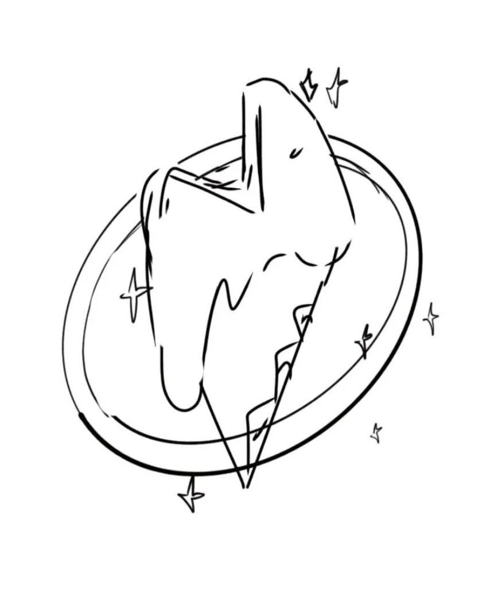

Croquis du logo, dessiné à la main, sans IA.

## Intention

O.R.I.O.N est né d'un rêve. Nous en avons gardé l'idée d'un lieu à la fois familier et légèrement étrange : un restaurant japonais où la course de frappe se joue comme un repas. On entre dans le restaurant, on prend le ticket de sa table, et les autres joueurs deviennent des convives assis au même comptoir.

Le style cherche un équilibre entre le rétro et le moderne. Le rétro vient du Japon des années 80, de la City Pop et du pop art ; le moderne vient d'une mise en page nette, lisible et « clean ». Entre les deux, nous avons voulu un décalage volontaire, un peu absurde, dans l'esprit d'un Japon décalé et inattendu : des poissons qui font la course dans un bassin, des tours de glace, un ticket de réservation en guise de salon. Les couleurs vives et saturées donnent au tout un côté enfantin et joyeux, qui contraste avec la rigueur de l'interface.

Les animations de poissons ont été dessinées à la main par Roro sur Krita, image par image. Ce trait fait main est au cœur de l'identité du site : il apporte la part d'imperfection et de chaleur que le reste de l'interface, plus géométrique, ne porte pas.

## Un seul thème

Le site n'a volontairement qu'un thème, sombre. Sa direction artistique repose sur des couleurs vives posées sur un fond nuit, à la manière des enseignes néon et des affiches City Pop : passer en thème clair éteindrait ces contrastes et dénaturerait l'ambiance du restaurant. Nous avons donc fait l'exception prévue pour une direction mono-thème.

En compensation, le site propose un second mode pensé pour l'accessibilité : un thème adapté aux daltonismes (CVD), avec une palette qui reste distinguable pour les personnes concernées. Le sélecteur permet de passer de l'un à l'autre, et le choix est conservé sans flash au chargement.

## Typographies

### Utilisées sur le site

| Rôle | Police | Usage |
|---|---|---|
| Titres et éléments japonais | **Shippori Mincho** (graisse 700, Google Fonts) | Titres, tampons, étiquettes, bassin de course |
| Texte courant | Police sans-serif du système (`system-ui`, San Francisco, Segoe UI, Roboto) | Interface, formulaires, paragraphes |
| Texte à taper, chiffres | Police monospace du système (`ui-monospace`, SF Mono, Menlo, Consolas) | Texte de la course, scores, MPM |

Shippori Mincho apporte le côté estampe et Japon rétro ; les polices du système gardent l'interface nette et rapide à charger, ce qui sert le côté « clean » et moderne.

### Pistes d'inspiration

Les polices suivantes ont servi d'inspiration pendant la recherche, sans être retenues telles quelles sur le site :

| Police | Ce qu'elle a apporté |
|---|---|
| 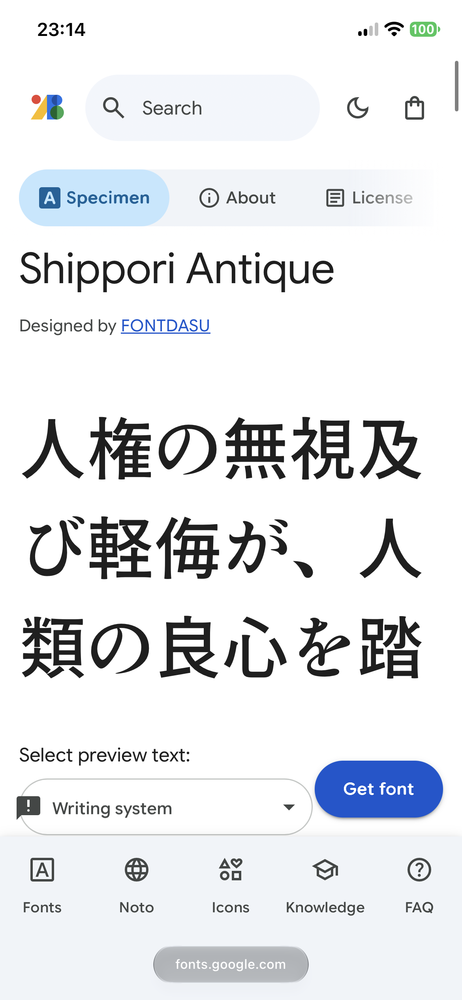 Shippori Antique | Le japonais lisible, qui a mené à Shippori Mincho |
| 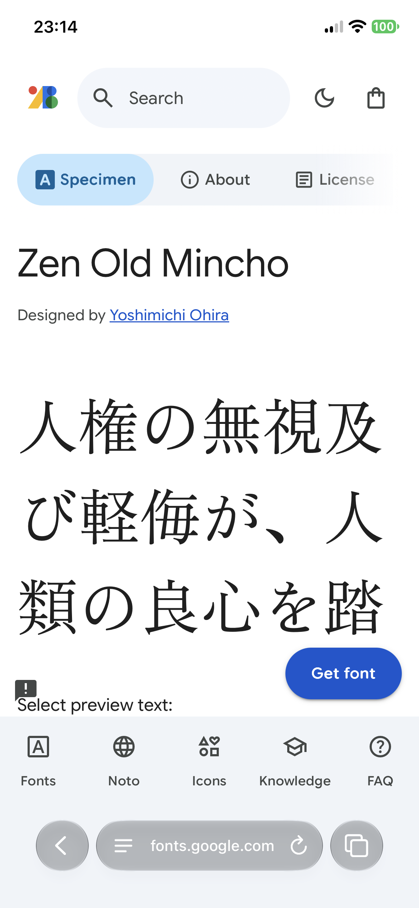 Zen Old Mincho | Le mincho classique, côté estampe |
| 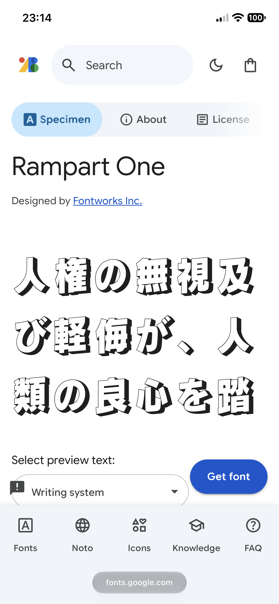 Rampart One | Le titrage japonais en relief, façon enseigne |
| 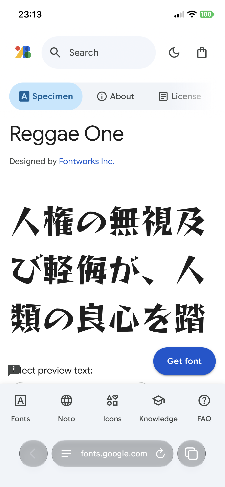 Reggae One | Le japonais épais et ludique |
| 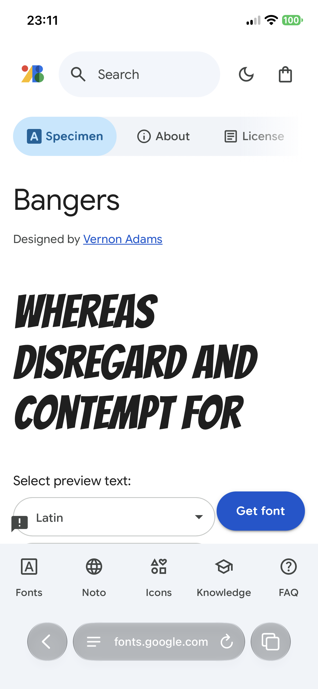 Bangers | Le titrage BD du pop art |
| 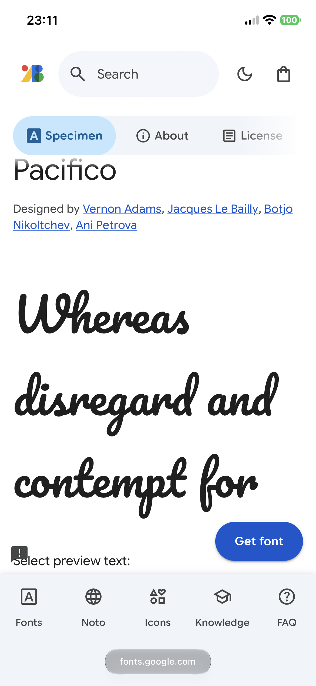 Pacifico | Les lettres rondes des enseignes rétro |
| 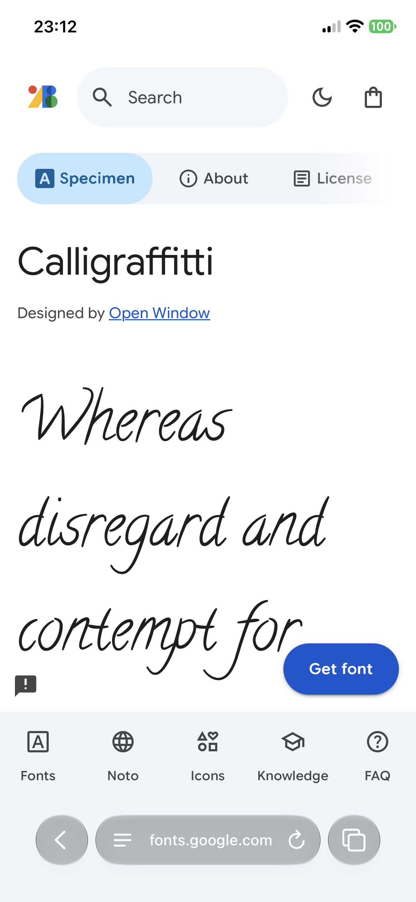 Caligraffitti | Le trait manuscrit, un peu sauvage |
| 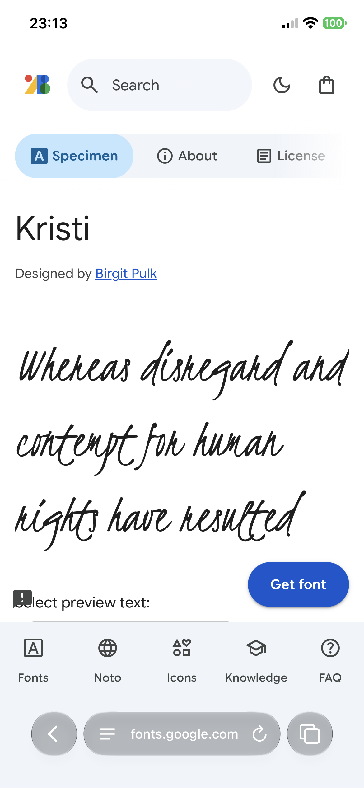 Kristi | L'écriture à la main |
| 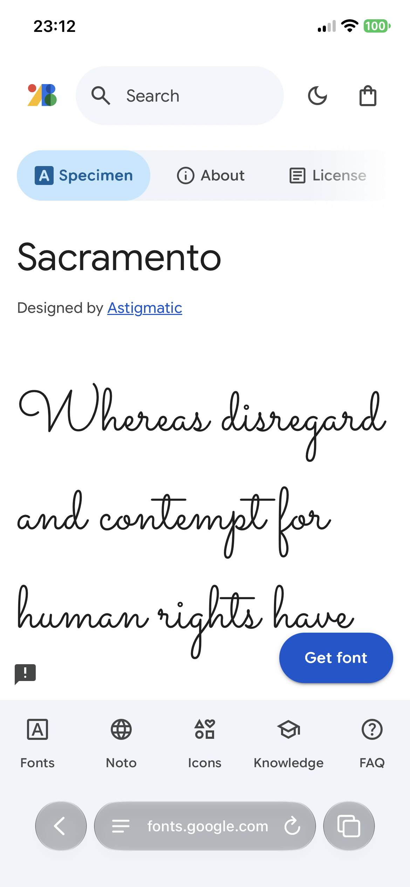 Sacramento | La script fine, façon néon |
| 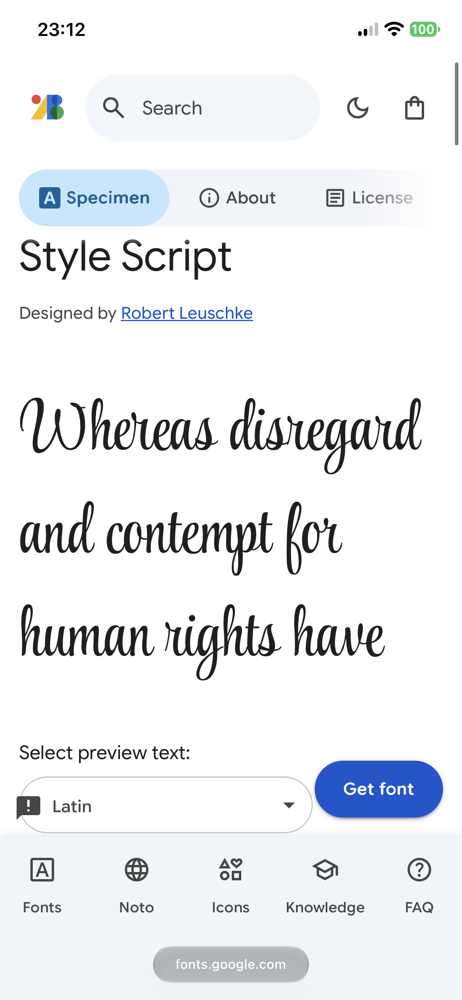 Style Script | La script rétro des menus et cartes |

## Moodboards

Cette partie regroupe les deux moodboards du dossier de design :

1. [Japan City Pop — 昭和レトロ / 東京](#1-japan-city-pop--昭和レトロ--東京)
2. [Pop Art — 個性 (kosei)](#2-pop-art--個性-こせい)

Les images sont tirées des fichiers `moodboard-Japan_City_Pop.docx` et `moodboard-Pop.docx`, et rangées dans `images/`.

---

## 1. Japan City Pop — 昭和レトロ / 東京

**Mots-clés :** 昭和レトロ (*Shōwa retro*, la nostalgie du Japon des années 70-80) · 東京 (*Tokyo*)

### Palette

| Couleur | Hex | Rôle suggéré |
|---|---|---|
|  Bleu nuit | `#1B1B3A` | Fond, texte foncé |
|  Rouge vermillon | `#E8231E` | Accent principal (couleur dominante de la planche) |
|  Bleu cobalt | `#1E3FC0` | Accent secondaire, aplats |
|  Bleu ciel pastel | `#8FC9D9` | Fond doux, trames |
|  Rose néon | `#E8358C` | Accents « néon » |
|  Jaune soleil | `#F2C230` | Accents chauds, mise en avant |

### Références

| | Image | Ce qu'on en retient |
|---|---|---|
| 1 | 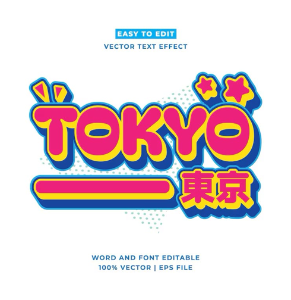 | Titrage « TOKYO 東京 » : lettres rondes et épaisses, rose et jaune, contour bleu en relief, petites étoiles et trame de points. |
| 2 | 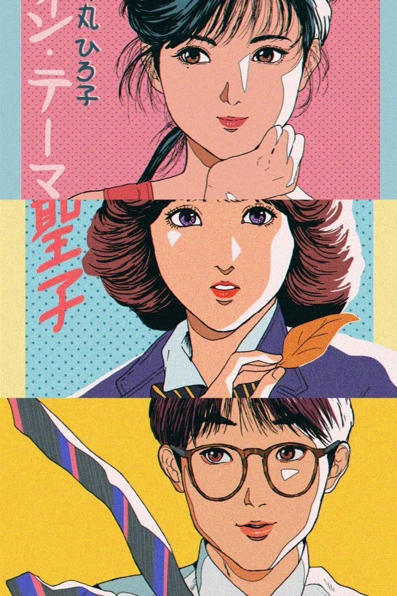 | Portraits façon anime/manga années 80 en bandes horizontales sur fonds pastel (rose, bleu ciel, jaune), trame de points et grain d'impression. |
| 3 | 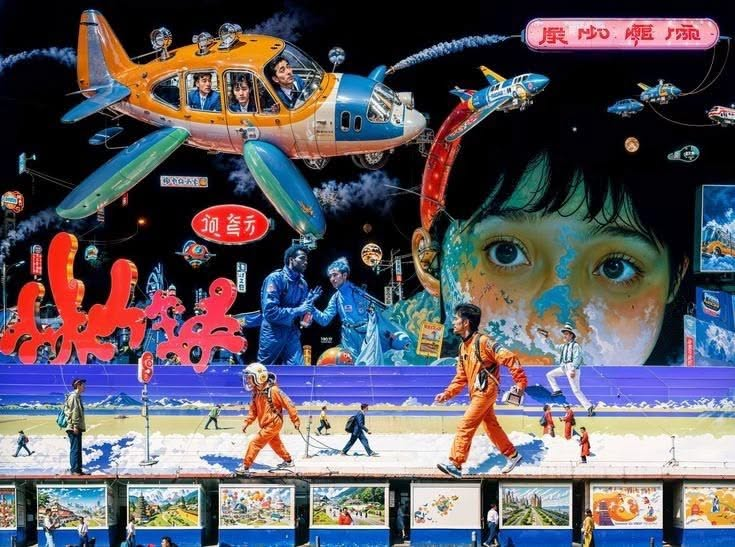 | Illustration rétrofuturiste très dense : avion-jouet, enseignes néon, panneaux d'affichage, personnages en combinaison orange sur fond noir. |
| 4 | 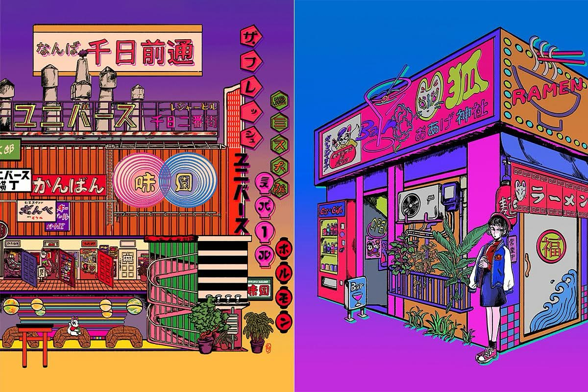 | Façades de rue (Namba, bar, ramen) en dégradés violet/bleu/orange, enseignes verticales en katakana, détails urbains (distributeur, clim, plantes). |
| 5 | 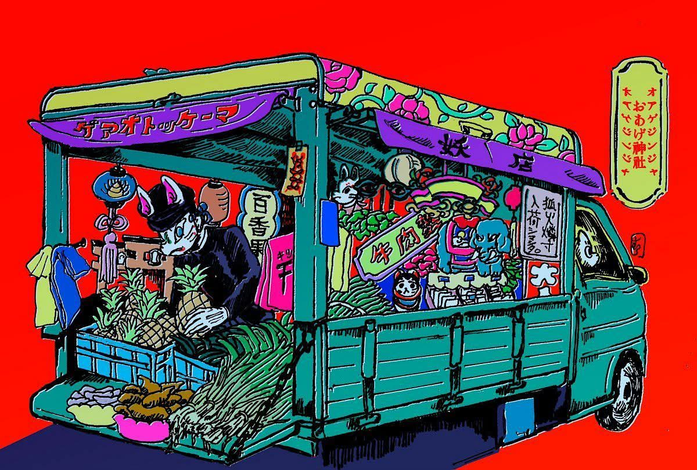 | Camion-boutique « 妖店 » au trait encré, fond rouge plein, couleurs saturées (vert canard, violet, jaune), masques de renard et lanternes. |
| 6 | 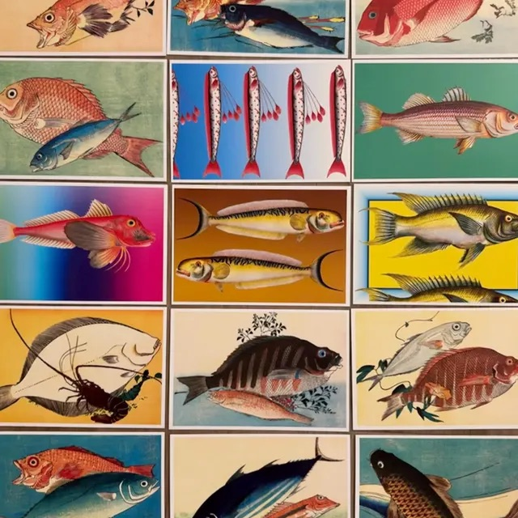 | Grille de cartes de poissons façon estampe (ukiyo-e), réinterprétées avec des fonds colorés et des dégradés modernes. |
| 7 | 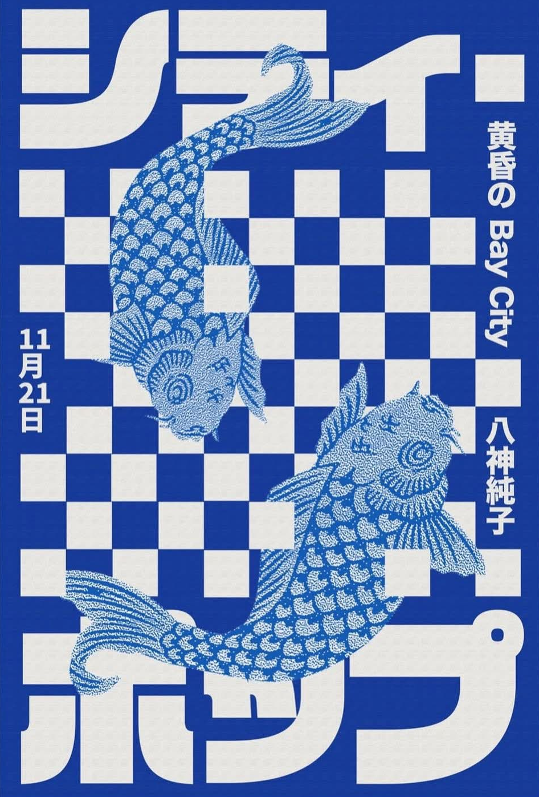 | Affiche « シティーポップ » en bichromie bleu/blanc : damier, deux carpes koï en gravure, typo japonaise géométrique et massive. |
| 8 | 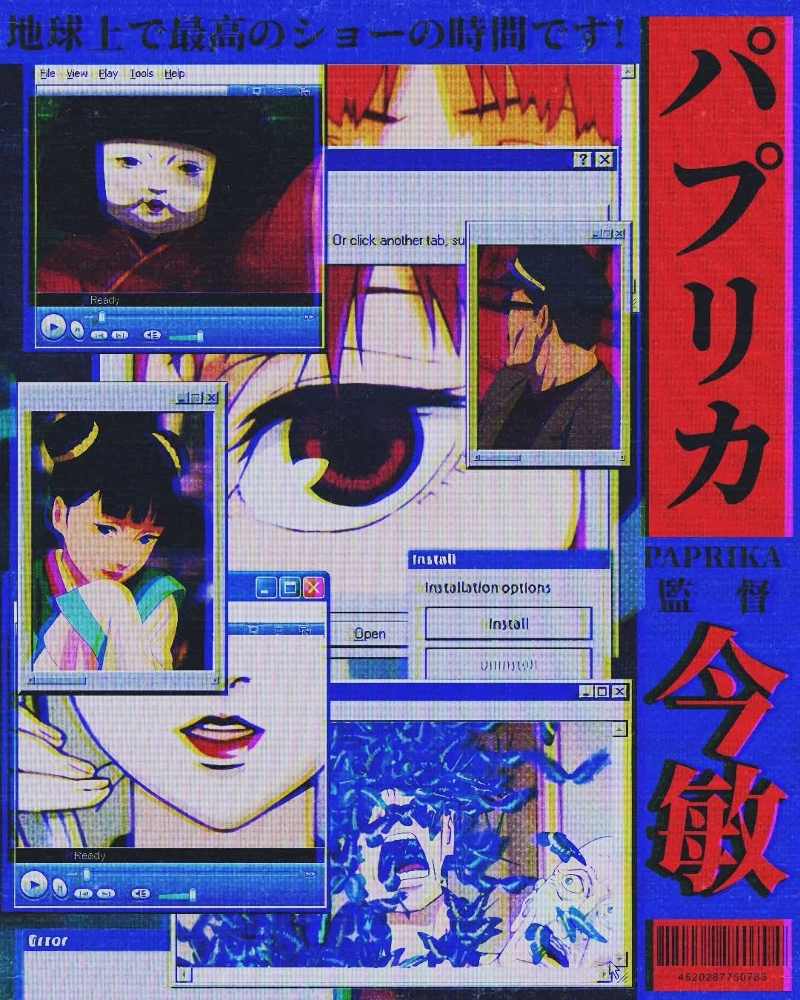 | Collage d'affiche « Paprika » : fenêtres Windows rétro, décalage RVB, grain VHS, rouge et bleu dominants, code-barres. |

### Lignes directrices

- **Couleurs** : franches et saturées, rouge et bleu en duo principal, relevés de rose néon et de jaune.
- **Texture** : trames de points, grain d'impression ou VHS, décalage chromatique.
- **Typographie** : japonais (katakana/kanji) en grand, souvent vertical ; titrages ronds et épais avec contour et relief.
- **Ambiance** : nostalgie urbaine des années 80, enseignes néon, rétrofuturisme, mélange de tradition (estampes, koï, kitsune) et de pop culture.

---

## 2. Pop Art — 個性 (こせい)

**Mots-clés :** POP ART · 個性 (*kosei*, la personnalité, l'individualité) · couleur · trame

### Palette

| Couleur | Hex | Rôle suggéré |
|---|---|---|
|  Jaune citron | `#F5E625` | Fond éclatant, mise en avant |
|  Rouge | `#E8262A` | Accent principal, titres |
|  Magenta | `#F0379A` | Accent |
|  Cyan | `#1EC8F0` | Accent froid |
|  Bleu roi | `#1E3FA6` | Aplats, contraste |
|  Noir | `#111111` | Contours, texte |

### Références

| | Image | Ce qu'on en retient |
|---|---|---|
| 1 | 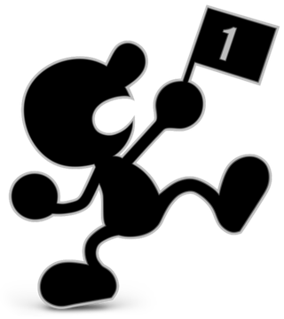 | Personnage-silhouette noir tenant un drapeau « 1 » : lisible, ludique, sans détails. |
| 2 | 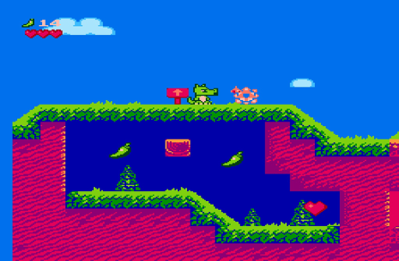 | Jeu de plateforme en pixel art 8 bits : couleurs vives, cœurs, ciel bleu. |
| 3 | 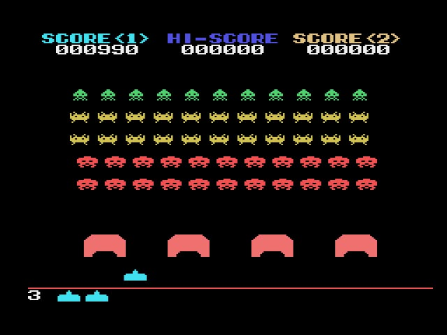 | Écran de shoot'em up arcade : fond noir, ennemis pixelisés colorés, typo de score rétro. |
| 4 | 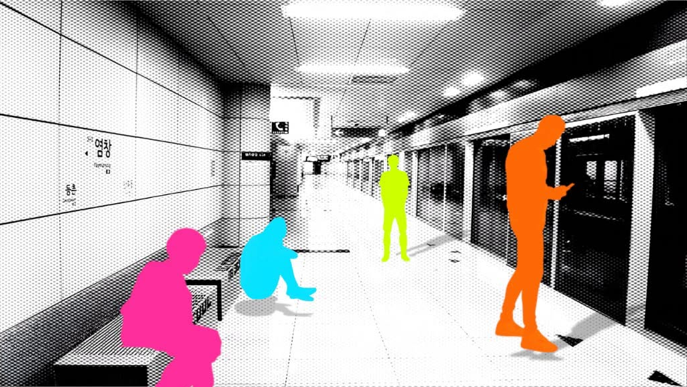 | Photo de quai de métro en trame noir et blanc, personnages en aplats fluo (rose, cyan, vert, orange) : le détail coloré qui ressort du décor. |
| 5 | 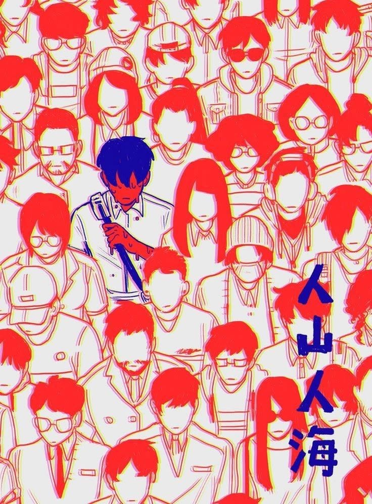 | Foule dessinée en rouge, un seul personnage en bleu, texte « 人山人海 » (une marée humaine) : l'individu dans la masse. |
| 6 | 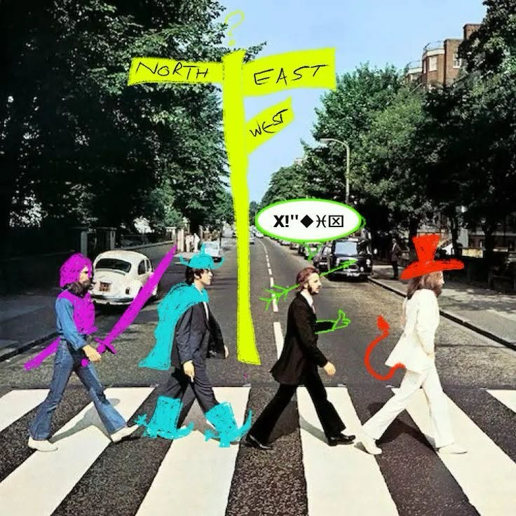 | Photo de passage piéton détournée avec des gribouillis fluo (panneau NORTH/EAST/WEST, chapeaux, épée) : humour et personnalisation. |
| 7 | 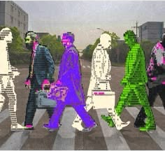 | Piétons transformés en silhouettes colorées et tramées. |
| 8 | 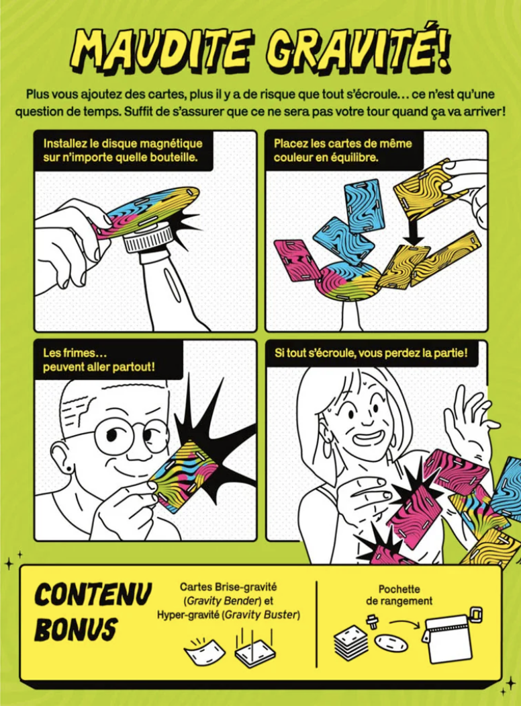 | Page de règles d'un jeu de société : fond vert anis, cases BD au trait noir, cartes aux motifs colorés, titre jaune contouré. |
| 9 | 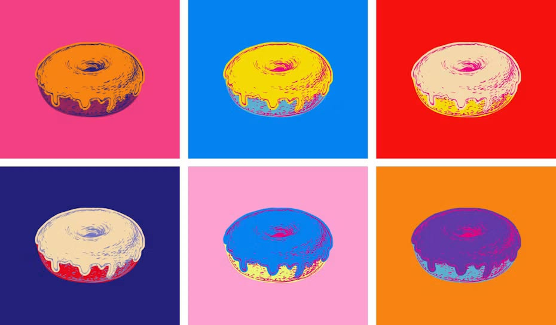 | Grille de donuts en variations de couleurs, à la manière des séries sérigraphiées pop art. |
| 10 | 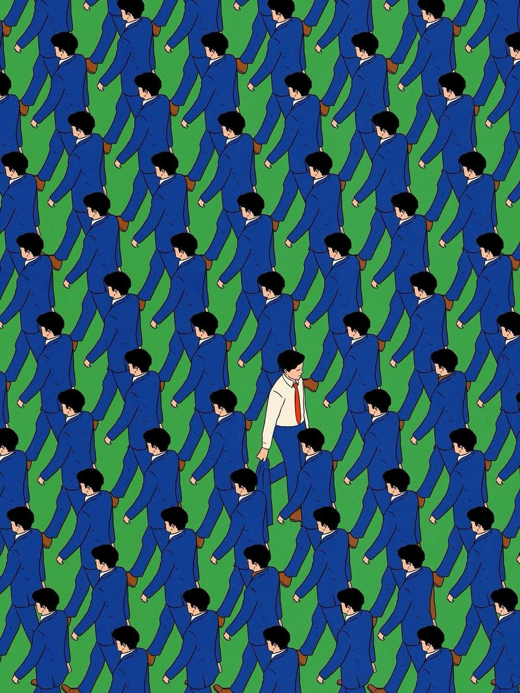 | Motif répété d'hommes en costume bleu sur fond vert, un seul en chemise blanche et cravate rouge. |
| 11 | 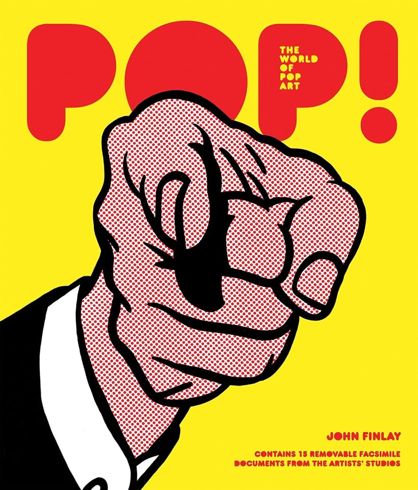 | Couverture de livre « POP! The World of Pop Art » : fond jaune, titre rouge arrondi, main qui pointe en trame de points façon BD. |

### Lignes directrices

- **Couleurs** : primaires et fluo (jaune, rouge, magenta, cyan, bleu) avec contours noirs.
- **Texture** : trames de points façon BD et sérigraphie, aplats nets.
- **Thème fort, 個性** : l'individu qui se distingue de la foule, par la couleur, l'attitude ou le contraste.
- **Ambiance** : ludique et rétro (jeu vidéo 8 bits, jeu de société, détournement de photos), lisible et graphique.

---

## Points communs entre les deux planches

- Palette saturée construite autour du **rouge**, du **bleu** et du **jaune**, avec un accent **rose/magenta**.
- **Trames de points** et effets d'impression comme texture récurrente.
- Typographies **grasses et arrondies**, avec contour et relief.
- Mélange de **rétro** (années 80, arcade, estampe) et de graphisme **pop** contemporain.
