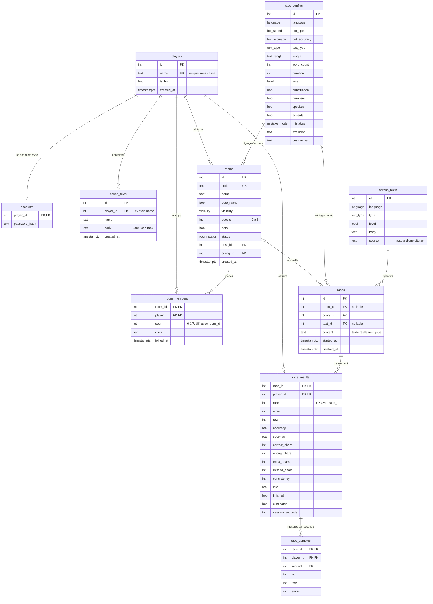

# Schéma de la base de données

PostgreSQL, géré avec Drizzle. Source de vérité : [db/schema/](../../db/schema/). Ce diagramme est à mettre à jour avec chaque nouvelle migration.

## Choix à connaître

- **`race_configs` est immuable.** Modifier les réglages d'un salon crée une nouvelle ligne et déplace `rooms.config_id`, pour que chaque course garde les réglages avec lesquels elle a été jouée.
- **`players` couvre humains, invités et bots.** Seuls les joueurs inscrits ont une ligne dans `accounts`.
- **La couleur appartient à la place** (`room_members.color`), pas au joueur.
- **`races.content` copie le texte joué**, pour que l'historique reste juste si le corpus change.

## Suppressions

| Quand on supprime… | Effet |
| --- | --- |
| un joueur | supprime son compte, ses textes et ses places ; refusé s'il héberge un salon ou a des résultats |
| un salon | supprime ses places ; ses courses restent, avec `room_id` à `NULL` |
| un texte du corpus | les courses gardent leur `content`, `text_id` passe à `NULL` |
| une course | supprime ses résultats et leurs mesures |
| un résultat | supprime ses mesures |
